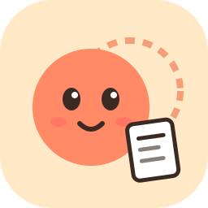
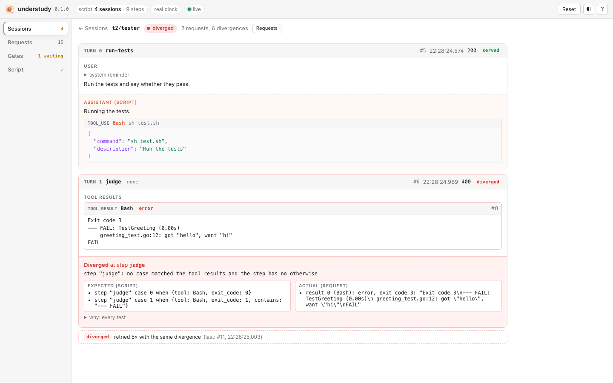
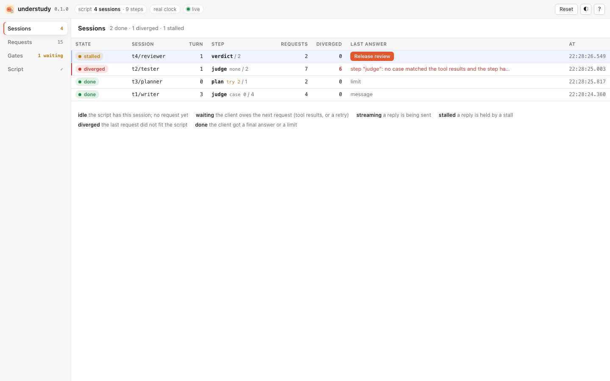
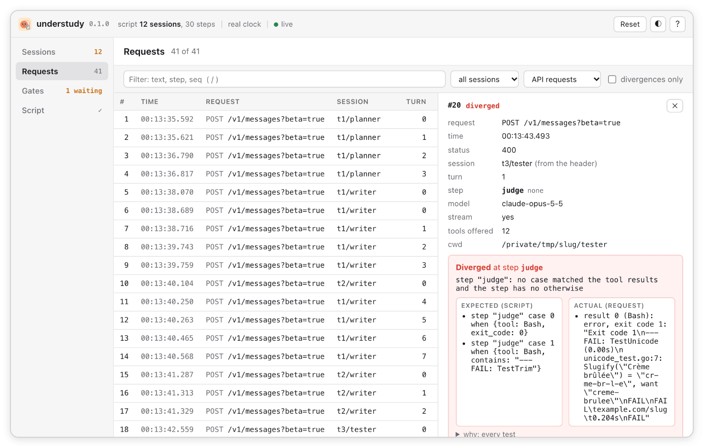
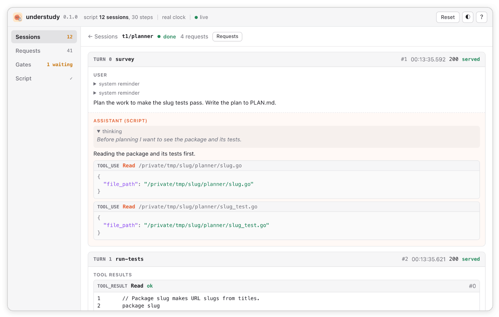
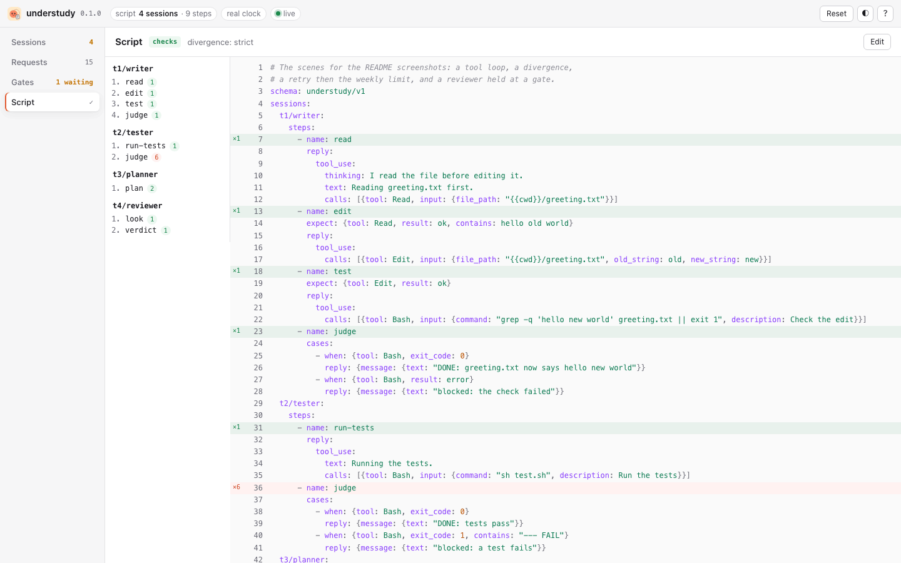
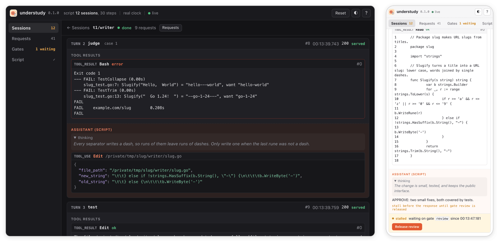

<p align="center">
  
</p>

<h1 align="center">understudy</h1>

<p align="center"><b>コーディングエージェントのためのフェイクAIモデル：トークンを節約し、エージェントのテストを毎回同じ結果にします。</b></p>

<p align="center">
  <a href="README.md">English</a> | <a href="README.ko.md">한국어</a> | <b>日本語</b> | <a href="README.zh-CN.md">简体中文</a>
</p>

## 概要

Claude Code や Codex などのコーディングエージェントは、リクエストを一つずつ HTTP API で AI モデルに送ります。**understudy** はフェイクモデルです。手元で動くサーバーで、そのリクエストに短い YAML スクリプトのとおりに答えます。フェイクモデルが各ステップで返す内容をスクリプトに書き、エージェントの接続先を understudy にして、本物のエージェントを実行します。フェイクなのはモデルだけです。エージェントはいつもどおりファイルを読んで編集し、コマンドを実行し、リトライし、応答をストリーミングで受け取ります。

そのため、エージェントのテストには API キーが要らず、トークンも消費せず、何度実行しても同じ結果になります。フェイクモデルは HTTP エラー、応答の停止（stall）、接続の切断、使用量の上限でも答えられ、そのときは本物の API と同じエラー本文とステータスコードを返します。各エージェントが障害ごとにどう動いたかの測定結果は [docs/limits.md](docs/limits.md) にあります。

<p align="center">
  <a href="docs/screenshots/hero-divergence.png"></a>
</p>

## 例：エージェントがファイルを編集するかテストする

[examples/2-edit-file.yaml](examples/2-edit-file.yaml) では、フェイクモデルがエージェントに `greeting.txt` を読ませ、続けて "hello" を "goodbye" に置き換えさせます。次の Go テストは、このスクリプトで本物の Claude Code を実行し、ディスク上のファイルを確かめます。

```go
func TestAgentEditsTheFile(t *testing.T) {
	fake := us.Start(t, us.ScriptFile("testdata/edit.yaml")) // examples/2-edit-file.yaml のコピー
	dir := us.TempDir(t, map[string]string{"greeting.txt": "hello world\n"})

	run := us.Claude(t, fake, us.Run{Dir: dir, Session: "t1/writer", Prompt: "Change the greeting to goodbye."})

	got, _ := os.ReadFile(filepath.Join(dir, "greeting.txt"))
	if run.Exit != 0 || string(got) != "goodbye world\n" {
		t.Fatalf("exit %d, greeting.txt is %q", run.Exit, got)
	}
}
```

`us` は `github.com/seungduk/understudy/understudytest` です（`go get github.com/seungduk/understudy/understudytest@latest` で追加）。`claude` がインストールされていなければ、テストはスキップされます。ほかのエージェントで同じテストを書く方法は [docs/go.md](docs/go.md) にあります。

## 必要なもの

- Go 1.25 以降。ビルド済みバイナリはまだありません。
- テストするエージェント。インストール済みで `PATH` にあること。クイックスタートでは Claude Code（`claude`）を使います。

## クイックスタート

```sh
go install github.com/seungduk/understudy/cmd/understudy@latest

cat > hello.yaml <<'YAML'
schema: understudy/v1
sessions:
  default:
    steps:
      - name: answer
        reply: {message: {text: "Hello from the understudy."}}
YAML

understudy serve --script hello.yaml &         # Web UI: http://127.0.0.1:8765/_understudy/ui/
eval "$(understudy env)"                       # このシェルの Claude Code がダミーキーで understudy に接続
claude -p "say hi" </dev/null                  # 出力: Hello from the understudy.
understudy explain --url http://127.0.0.1:8765 # 各リクエストにどのスクリプトステップが答えたかを理由付きで表示
```

`understudy env` が本物の Anthropic キーを外すのはこのシェルの中だけです。本物のモデルに戻すには新しいシェルを開いてください。スクリプトではツールを呼び出したり、コマンドの出力で分岐したり、エラーを返したりもできます。[SCRIPTS.md](SCRIPTS.md) を参照してください。`understudy validate FILE` はスクリプトを検査し、問題ごとに直し方を示します。

## この README の用語

- **セッション（session）**：スクリプト内の一つの会話。`t1/writer` のようなキーで名前を付けます。エージェントはリクエストごとにこのキーを送り、キーのないリクエストは `default` セッションに入ります。
- **ステップ（step）**：スクリプトに書いた一つの答え。ステップ 1 がセッションの最初のリクエストに答え、ステップ 2 がその次に答える、という順です。
- **不一致（divergence）**：スクリプトが予想していないリクエスト。既定では understudy がエラーで答え、スクリプトが期待した内容とエージェントが送った内容を並べて見せます。
- **ゲート（gate）**：名前の付いた一時停止。`stall: {gate: NAME}` のステップは、ゲートを解除するまで答えを返しません。

## ほかのエージェントで使う

`understudy setup` は、空のフォルダー（下の例では `./agent-home`）にエージェントの設定ファイルを書いてそこをエージェントのホームにし、ダミーキーでエージェントを understudy に向けて実行するコマンドを表示します。セッションを選ぶには `--session KEY` を付けます。

| エージェント | 設定コマンド |
|---|---|
| Claude Code | `eval "$(understudy env)"` |
| OpenAI Codex CLI | `understudy setup --harness codex --home ./agent-home` |
| opencode | `understudy setup --harness opencode --home ./agent-home` |
| pi | `understudy setup --harness pi --home ./agent-home` |
| Gemini CLI | `understudy setup --harness gemini-cli --home ./agent-home` |
| Antigravity CLI | `understudy setup --harness antigravity --home ./agent-home` |

各エージェントが使う API、`setup` が書くファイル、テストしたエージェントのバージョンは [docs/harnesses.md](docs/harnesses.md) にあります。

## Web UI と MCP

`understudy serve` は `/_understudy/ui/` で Web UI も提供します。各セッションの状態、各リクエストに答えたステップ、不一致、読み込んだスクリプトを表示し、ゲートを解除するボタンもあります（[詳しく](docs/web-ui.md)）。

`understudy mcp` は同じ機能を Model Context Protocol（MCP）のツールとして AI エージェントに提供します。エージェントはスクリプトを書いて検査し、エージェントを understudy に向けて実行するコマンドを受け取り、リクエストログを読み、ゲートを解除できます（[詳しく](docs/mcp.md)）。

<table>
  <tr>
    <td width="50%" valign="top"><a href="docs/screenshots/sessions.png"></a><br><sub><b>セッション</b>：各セッションの状態、現在のステップ、リクエスト数。止まったゲートはここで解除します。</sub></td>
    <td width="50%" valign="top"><a href="docs/screenshots/requests.png"></a><br><sub><b>リクエスト</b>：エージェントが送ったすべてのリクエスト。一つ開くと、スクリプトが期待した内容と並べて見られます。</sub></td>
  </tr>
  <tr>
    <td width="50%" valign="top"><a href="docs/screenshots/conversation.png"></a><br><sub><b>セッション履歴</b>：プロンプト、フェイクモデルがスクリプトどおりに返した答え、エージェントが返したツール結果。</sub></td>
    <td width="50%" valign="top"><a href="docs/screenshots/script.png"></a><br><sub><b>スクリプト</b>：読み込んだ YAML スクリプトと、各ステップがこれまでに答えたリクエスト数。</sub></td>
  </tr>
  <tr>
    <td colspan="2"><a href="docs/screenshots/dark-mobile.png"></a><br><sub><b>スマートフォンとダークモード</b>：Web UI は狭い画面でもダークモードでも使えます。</sub></td>
  </tr>
</table>

## さらに詳しく

- [SCRIPTS.md](SCRIPTS.md)：スクリプトの形式、すべてのフィールド、実例
- [機能](docs/features.md)：API、障害、実際の通信の記録、Go テストヘルパー
- [エージェント](docs/harnesses.md)：エージェントごとの設定方法と、テストしたバージョン
- [障害と上限](docs/limits.md)：API エラー、応答の停止、使用量の上限で各エージェントがしたこと（実測）
- [記録と再生](docs/recording.md) · [Go ライブラリ](docs/go.md) · [コントロール API](docs/control-api.md)
- [Web UI](docs/web-ui.md) · [MCP サーバー](docs/mcp.md) · [テスト](docs/testing.md) · [アーキテクチャ](docs/ARCHITECTURE.md)
- [クレジットと参考資料](docs/credits.md) · [コントリビュート](CONTRIBUTING.md)

## ライセンス

Apache-2.0。「Claude」と「Anthropic」は Anthropic の商標、「OpenAI」と「Codex」は OpenAI の商標、
「Gemini」と「Antigravity」は Google の商標、「DeepSeek」は DeepSeek の商標です。understudy はこれらのいずれとも
提携しておらず、承認も受けていません。
