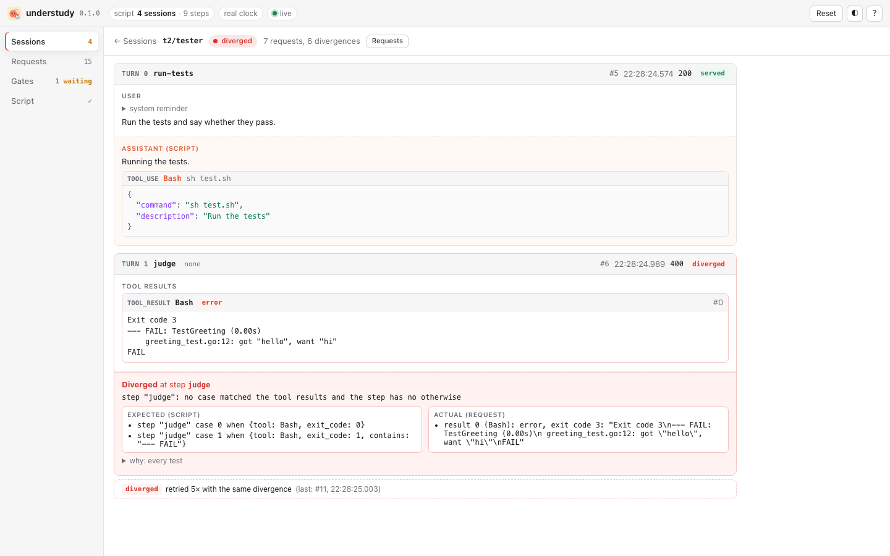

<p align="center">
  
</p>

<h1 align="center">understudy</h1>

<p align="center"><b>코딩 에이전트를 위한 가짜 AI 모델: 토큰을 아끼고, 에이전트 테스트가 매번 같은 결과를 내게 합니다.</b></p>

<p align="center">
  <a href="README.md">English</a> | <b>한국어</b> | <a href="README.ja.md">日本語</a> | <a href="README.zh-CN.md">简体中文</a>
</p>

## 소개

Claude Code나 Codex 같은 코딩 에이전트는 요청 하나하나를 HTTP API로 AI 모델에 보냅니다. **understudy**는 가짜 모델입니다. 내 컴퓨터에서 도는 서버로, 이 요청에 짧은 YAML 스크립트대로 답합니다. 가짜 모델이 단계마다 할 말을 스크립트에 쓰고, 에이전트가 understudy에 접속하게 한 다음, 실제 에이전트를 실행하면 됩니다. 가짜인 것은 모델뿐입니다. 에이전트는 평소처럼 파일을 읽고 고치며, 명령을 실행하고, 재시도하고, 응답을 스트리밍으로 받습니다.

그래서 에이전트 테스트에 API 키가 필요 없고, 토큰을 쓰지 않으며, 몇 번을 돌려도 결과가 같습니다. 가짜 모델은 HTTP 에러, 응답 지연(stall), 연결 끊김, 사용량 한도로도 답할 수 있으며, 이때 실제 API가 보내는 것과 같은 에러 본문과 상태 코드를 보냅니다. 각 에이전트가 장애마다 어떻게 반응했는지 측정한 결과는 [docs/limits.md](docs/limits.md)에 있습니다.

<p align="center">
  <a href="docs/screenshots/hero-divergence.png"></a>
</p>

## 예제: 에이전트가 파일을 고치는지 테스트하기

[examples/2-edit-file.yaml](examples/2-edit-file.yaml)에서 가짜 모델은 에이전트에게 `greeting.txt`를 읽게 한 뒤 "hello"를 "goodbye"로 바꾸게 합니다. 아래 Go 테스트는 이 스크립트로 실제 Claude Code를 실행하고, 디스크의 파일을 확인합니다.

```go
func TestAgentEditsTheFile(t *testing.T) {
	fake := us.Start(t, us.ScriptFile("testdata/edit.yaml")) // examples/2-edit-file.yaml의 사본
	dir := us.TempDir(t, map[string]string{"greeting.txt": "hello world\n"})

	run := us.Claude(t, fake, us.Run{Dir: dir, Session: "t1/writer", Prompt: "Change the greeting to goodbye."})

	got, _ := os.ReadFile(filepath.Join(dir, "greeting.txt"))
	if run.Exit != 0 || string(got) != "goodbye world\n" {
		t.Fatalf("exit %d, greeting.txt is %q", run.Exit, got)
	}
}
```

`us`는 `github.com/seungduk/understudy/understudytest`입니다(`go get github.com/seungduk/understudy/understudytest@latest`로 추가). `claude`가 설치되어 있지 않으면 테스트는 건너뜁니다. 다른 에이전트로 같은 테스트를 쓰는 방법은 [docs/go.md](docs/go.md)에 있습니다.

## 준비물

- Go 1.25 이상. 미리 빌드한 바이너리는 아직 없습니다.
- 테스트할 에이전트. 설치되어 있고 `PATH`에 있어야 합니다. 빠른 시작에서는 Claude Code(`claude`)를 씁니다.

## 빠른 시작

```sh
go install github.com/seungduk/understudy/cmd/understudy@latest

cat > hello.yaml <<'YAML'
schema: understudy/v1
sessions:
  default:
    steps:
      - name: answer
        reply: {message: {text: "Hello from the understudy."}}
YAML

understudy serve --script hello.yaml &         # 웹 UI: http://127.0.0.1:8765/_understudy/ui/
eval "$(understudy env)"                       # 이 셸의 Claude Code가 더미 키로 understudy에 접속
claude -p "say hi" </dev/null                  # 출력: Hello from the understudy.
understudy explain --url http://127.0.0.1:8765 # 요청마다 어느 스크립트 단계가 답했는지, 그 이유와 함께 출력
```

`understudy env`는 이 셸에서만 실제 Anthropic 키를 지웁니다. 실제 모델을 다시 쓰려면 새 셸을 여세요. 스크립트로 도구를 호출하고, 명령 출력에 따라 분기하고, 에러를 돌려줄 수도 있습니다. [SCRIPTS.md](SCRIPTS.md)를 보세요. `understudy validate FILE`은 스크립트를 검사하고 문제마다 고치는 방법을 알려 줍니다.

## 여기서 쓰는 용어

- **세션(session)**: 스크립트 안의 대화 하나. `t1/writer` 같은 키로 이름을 붙입니다. 에이전트는 요청마다 이 키를 보내며, 키가 없는 요청은 `default` 세션으로 갑니다.
- **단계(step)**: 스크립트에 적힌 답 하나. 1단계가 세션의 첫 요청에 답하고, 2단계가 그다음 요청에 답하는 식입니다.
- **불일치(divergence)**: 스크립트가 예상하지 않은 요청. 기본적으로 understudy는 에러로 답하고, 스크립트가 기대한 내용과 에이전트가 보낸 내용을 나란히 보여 줍니다.
- **게이트(gate)**: 이름 붙은 일시 정지. `stall: {gate: NAME}`인 단계는 게이트를 풀어 줄 때까지 답을 보내지 않습니다.

## 다른 에이전트와 함께 쓰기

`understudy setup`은 비어 있는 폴더(아래에서는 `./agent-home`)에 에이전트 설정 파일을 써서 그 폴더를 에이전트의 홈으로 만들고, 더미 키로 에이전트를 understudy에 붙여 실행하는 명령을 출력합니다. 세션을 고르려면 `--session KEY`를 붙이세요.

| 에이전트 | 설정 명령 |
|---|---|
| Claude Code | `eval "$(understudy env)"` |
| OpenAI Codex CLI | `understudy setup --harness codex --home ./agent-home` |
| opencode | `understudy setup --harness opencode --home ./agent-home` |
| pi | `understudy setup --harness pi --home ./agent-home` |
| Gemini CLI | `understudy setup --harness gemini-cli --home ./agent-home` |
| Antigravity CLI | `understudy setup --harness antigravity --home ./agent-home` |

각 에이전트가 쓰는 API, `setup`이 쓰는 파일, 테스트한 에이전트 버전은 [docs/harnesses.md](docs/harnesses.md)에 있습니다.

## 웹 UI와 MCP

`understudy serve`는 `/_understudy/ui/`에서 웹 UI도 제공합니다. 세션마다 상태, 요청마다 답한 단계, 불일치, 불러온 스크립트를 보여 주고, 게이트를 푸는 버튼도 있습니다([자세히 보기](docs/web-ui.md)).

`understudy mcp`는 같은 기능을 Model Context Protocol(MCP) 도구로 AI 에이전트에게 제공합니다. 에이전트는 스크립트를 쓰고 검사하며, 에이전트를 understudy에 붙여 실행하는 명령을 받고, 요청 로그를 읽고, 게이트를 풀 수 있습니다([자세히 보기](docs/mcp.md)).

<table>
  <tr>
    <td width="50%" valign="top"><a href="docs/screenshots/sessions.png"></a><br><sub><b>세션</b>: 세션마다 상태, 현재 단계, 요청 수. 멈춘 게이트를 여기서 풉니다.</sub></td>
    <td width="50%" valign="top"><a href="docs/screenshots/requests.png"></a><br><sub><b>요청</b>: 에이전트가 보낸 모든 요청. 하나를 열면 스크립트가 기대한 내용과 나란히 보입니다.</sub></td>
  </tr>
  <tr>
    <td width="50%" valign="top"><a href="docs/screenshots/conversation.png"></a><br><sub><b>세션 기록</b>: 프롬프트, 가짜 모델이 스크립트대로 한 답, 에이전트가 돌려보낸 도구 결과.</sub></td>
    <td width="50%" valign="top"><a href="docs/screenshots/script.png"></a><br><sub><b>스크립트</b>: 불러온 YAML 스크립트와, 단계마다 지금까지 답한 요청 수.</sub></td>
  </tr>
  <tr>
    <td colspan="2"><a href="docs/screenshots/dark-mobile.png"></a><br><sub><b>휴대폰과 다크 모드</b>: 웹 UI는 좁은 화면과 다크 모드에서도 쓸 수 있습니다.</sub></td>
  </tr>
</table>

## 더 알아보기

- [SCRIPTS.md](SCRIPTS.md): 스크립트 형식, 모든 필드, 실제 예제
- [기능](docs/features.md): API, 장애, 실제 트래픽 기록, Go 테스트 도우미
- [에이전트](docs/harnesses.md): 에이전트별 설정 방법과 테스트한 버전
- [장애와 한도](docs/limits.md): API 에러, 응답 지연, 사용량 한도에서 각 에이전트가 한 일(측정값)
- [기록과 재생](docs/recording.md) · [Go 라이브러리](docs/go.md) · [제어 API](docs/control-api.md)
- [웹 UI](docs/web-ui.md) · [MCP 서버](docs/mcp.md) · [테스트](docs/testing.md) · [아키텍처](docs/ARCHITECTURE.md)
- [참고 자료](docs/credits.md) · [기여하기](CONTRIBUTING.md)

## 라이선스

Apache-2.0. "Claude"와 "Anthropic"은 Anthropic의 상표이고, "OpenAI"와 "Codex"는 OpenAI의 상표이며,
"Gemini"와 "Antigravity"는 Google의 상표이고, "DeepSeek"는 DeepSeek의 상표입니다. understudy는 이들 중 어느
곳과도 제휴하지 않았고 보증도 받지 않았습니다.
