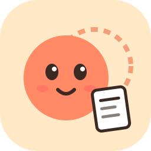
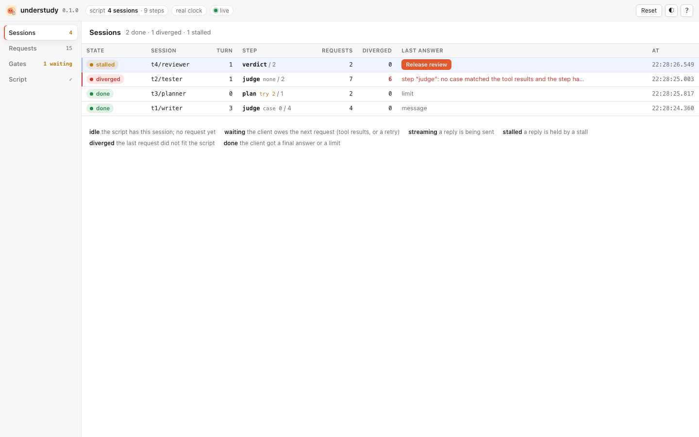
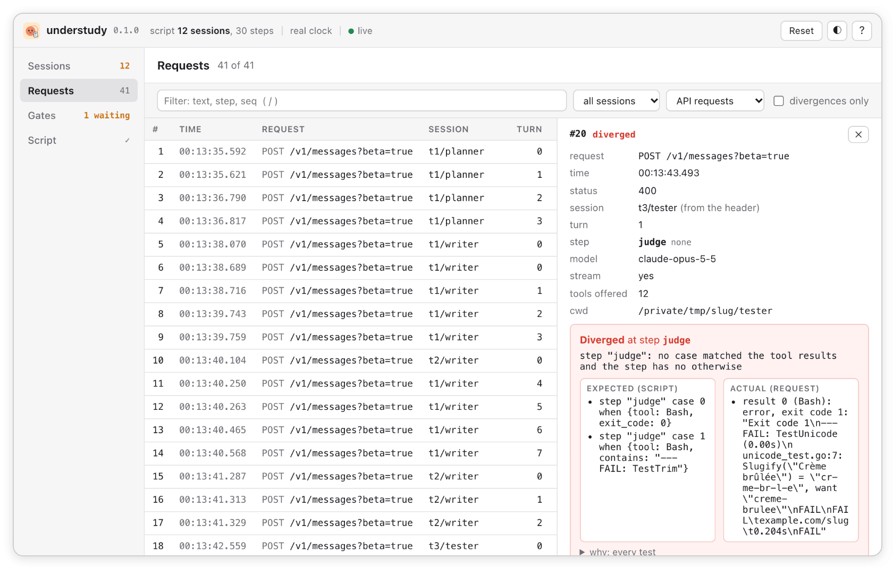
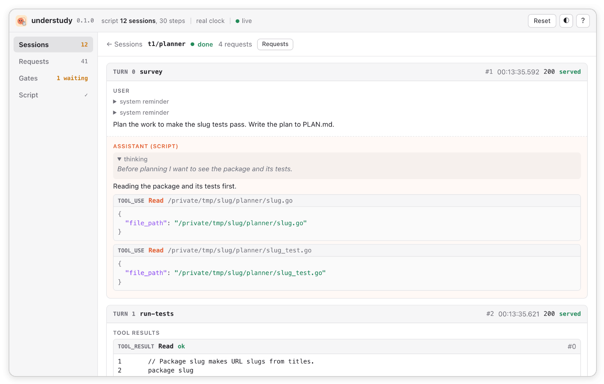
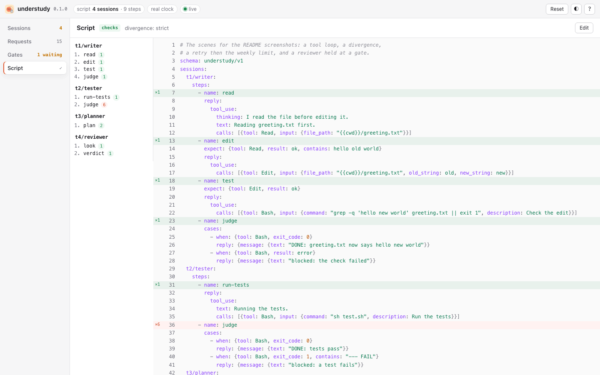
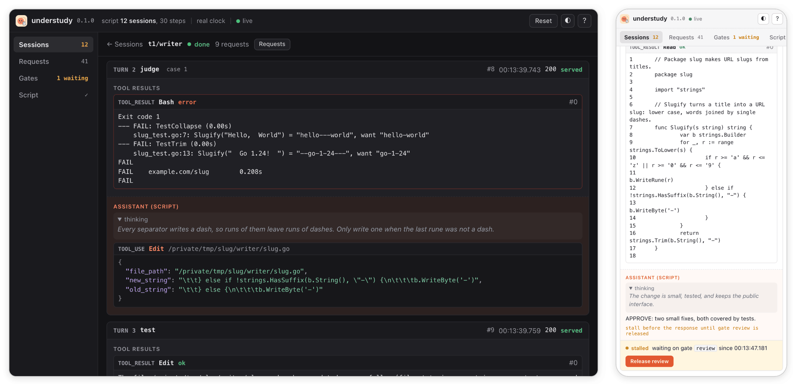

<p align="center">
  
</p>

<h1 align="center">understudy</h1>

<p align="center"><b>코딩 에이전트를 위한 가짜 AI 모델: 토큰을 절약하고 결정론적인 에이전트 테스트를 구축하세요.</b></p>

<p align="center">
  <a href="README.md">English</a> | <b>한국어</b> | <a href="README.ja.md">日本語</a> | <a href="README.zh-CN.md">简体中文</a>
</p>

## 소개

코딩 에이전트는 HTTP API를 통해 대규모 언어 모델(LLM)과 통신합니다. **understudy**는 간단한 YAML 스크립트를 사용해 이러한 모델 API를 모킹(mocking)합니다. 각 턴마다 가짜 모델이 응답할 내용을 정의하고 실제 에이전트가 understudy를 바라보도록 설정하기만 하면 됩니다. 에이전트는 실제 환경과 동일하게 파일을 읽고 수정하며, 명령어를 실행하고, 재시도하며 응답을 스트리밍합니다.

실제 모델 호출이나 API 키 없이 동작하므로, 에이전트 테스트 스위트가 수 밀리초 만에 빠르게 실행되며 매번 100% 동일한 결과를 보장합니다. 또한 실제 프로바이더 API와 동일한 상태 코드 및 페이로드로 HTTP 에러, 지연(stall), 연결 끊김, 사용량 한도(rate limit)를 시뮬레이션할 수 있습니다.

<p align="center">
  <a href="docs/screenshots/hero-divergence.png"></a>
</p>

## 빠른 시작

```sh
go install github.com/seungduk/understudy/cmd/understudy@latest

cat > hello.yaml <<'YAML'
schema: understudy/v1
sessions:
  default:
    steps:
      - name: answer
        reply: {message: {text: "Hello from the understudy."}}
YAML

understudy serve --script hello.yaml &         # 웹 UI: http://127.0.0.1:8765/_understudy/ui/
eval "$(understudy env)"                       # Claude Code가 더미 자격증명으로 understudy를 바라보도록 설정
claude -p "say hi" </dev/null                  # 출력: Hello from the understudy.
understudy explain --url http://127.0.0.1:8765 # 각 요청에 어떤 스텝이 응답했는지 이유 출력
```

스크립트는 도구 호출, 명령어 실행 결과에 따른 분기, 재시도 처리, 모의 에러 주입도 지원합니다. 자세한 작성법은 [SCRIPTS.md](SCRIPTS.md)를 참고하세요. `understudy validate FILE` 명령어로 스크립트를 검증하고 수정 제안을 확인할 수 있습니다.

## 다른 하네스(Harness)와 함께 사용하기

`understudy setup` 명령어는 격리된 홈 디렉터리에 각 하네스의 설정 파일을 생성하고, 더미 키를 사용해 understudy를 대상으로 실행하는 명령어를 출력합니다 (`--session KEY`로 세션 이름을 지정할 수 있습니다).

| 하네스 | 설정 명령어 |
|---|---|
| Claude Code | `eval "$(understudy env)"` |
| OpenAI Codex CLI | `understudy setup --harness codex --home /tmp/h` |
| opencode | `understudy setup --harness opencode --home /tmp/h` |
| pi | `understudy setup --harness pi --home /tmp/h` |
| Gemini CLI | `understudy setup --harness gemini-cli --home /tmp/h` |
| Antigravity CLI | `understudy setup --harness antigravity --home /tmp/h` |

지원 프로토콜, 생성되는 설정 파일, 테스트 완료된 CLI 버전 목록은 [docs/harnesses.md](docs/harnesses.md)에서 확인할 수 있습니다.

## 웹 UI 및 MCP

`understudy serve`는 `/_understudy/ui/`에서 실시간 웹 UI를 제공합니다. 활성 세션 상태 모니터링, 각 턴별 응답 스텝 추적, 스크립트 불일치(divergence) 검사, 일시 정지된 게이트 수동 해제, 로드된 스크립트 확인 등을 브라우저에서 바로 수행할 수 있습니다 ([자세히 보기](docs/web-ui.md)).

`understudy mcp`는 Model Context Protocol(MCP) 도구를 통해 이러한 기능을 AI 에이전트에게 제공합니다. 에이전트가 직접 스크립트를 작성하고 검증하며, 하네스 CLI를 실행하고, 요청 로그를 분석하거나 게이트를 해제할 수 있습니다 ([자세히 보기](docs/mcp.md)).

<table>
  <tr>
    <td width="50%" valign="top"><a href="docs/screenshots/sessions.png"></a><br><sub><b>세션 관리</b>: 세션 상태, 턴 수, 스텝 수 확인 및 일시 정지된 게이트 해제</sub></td>
    <td width="50%" valign="top"><a href="docs/screenshots/requests.png"></a><br><sub><b>요청 로그</b>: 전체 요청 로그 탐색 및 페이로드 차이점 상세 비교</sub></td>
  </tr>
  <tr>
    <td width="50%" valign="top"><a href="docs/screenshots/conversation.png"></a><br><sub><b>대화 내역</b>: 프롬프트, 스크립트 응답, 클라이언트 도구 실행 결과 확인</sub></td>
    <td width="50%" valign="top"><a href="docs/screenshots/script.png"></a><br><sub><b>스크립트 뷰어</b>: 현재 활성화된 YAML 스크립트 및 스텝별 호출 횟수 확인</sub></td>
  </tr>
  <tr>
    <td colspan="2"><a href="docs/screenshots/dark-mobile.png"></a><br><sub><b>반응형 모바일 & 다크 모드</b>: 완벽한 다크 모드 및 모바일 화면 지원</sub></td>
  </tr>
</table>

## 더 알아보기

- [SCRIPTS.md](SCRIPTS.md): 스크립트 형식 가이드, 스키마 필드 명세 및 전체 예제
- [주요 기능](docs/features.md): 지원 유선 프로토콜, 결함 주입, 트래픽 기록 및 Go 테스트 헬퍼
- [하네스 가이드](docs/harnesses.md): 각 하네스별 설정 방법 및 테스트 검증 버전 매트릭스
- [결함 및 사용량 제한](docs/limits.md): API 에러 및 속도 제한에 대한 각 하네스의 실측 동작
- [기록 및 재생](docs/recording.md) · [Go 라이브러리](docs/go.md) · [제어 API](docs/control-api.md)
- [웹 UI](docs/web-ui.md) · [MCP 서버](docs/mcp.md) · [테스트 가이드](docs/testing.md) · [아키텍처](docs/ARCHITECTURE.md)
- [참고 프로젝트](docs/credits.md) · [기여 가이드](CONTRIBUTING.md)

## 라이선스

Apache-2.0. "Claude" 및 "Anthropic"은 Anthropic의 상표입니다. "OpenAI" 및 "Codex"는 OpenAI의 상표입니다.
"Gemini" 및 "Antigravity"는 Google의 상표입니다. "DeepSeek"는 DeepSeek의 상표입니다. understudy는 이들 기관과 제휴하거나 승인을 받지 않았습니다.
