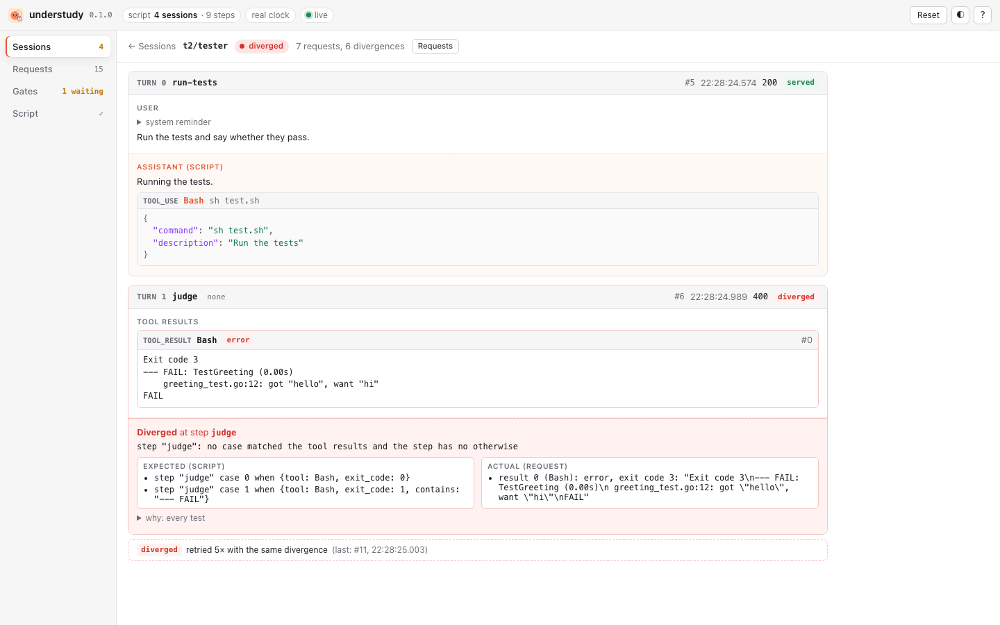
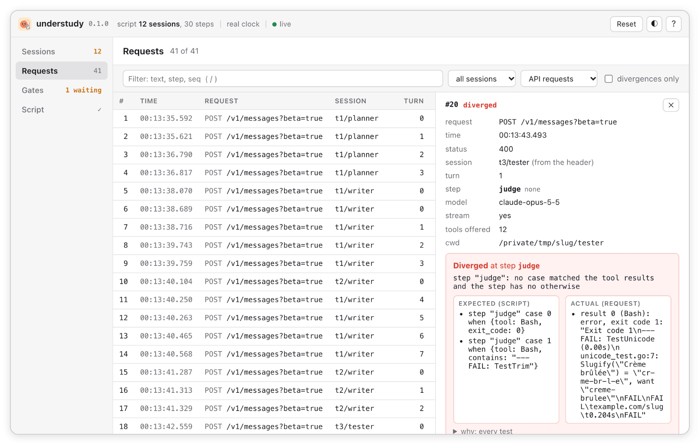
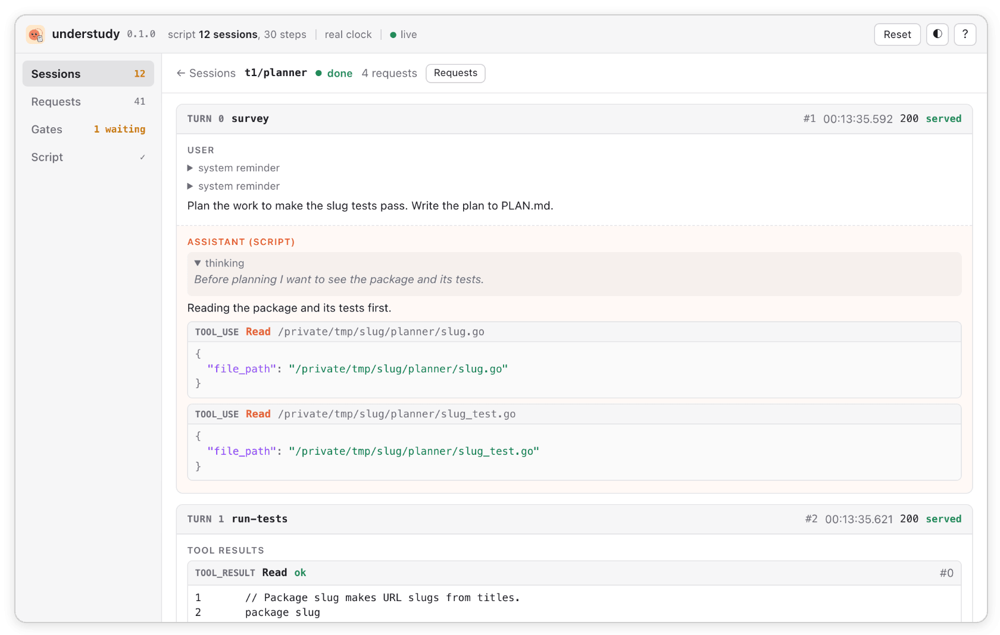
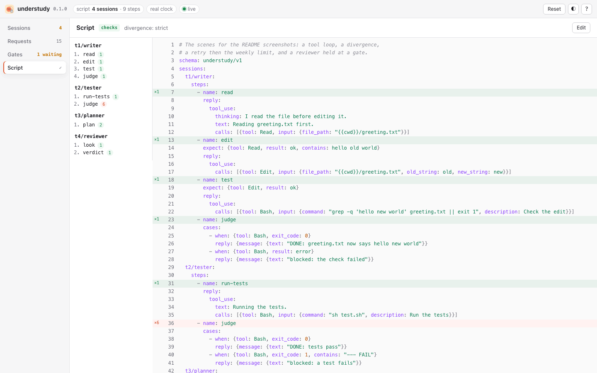
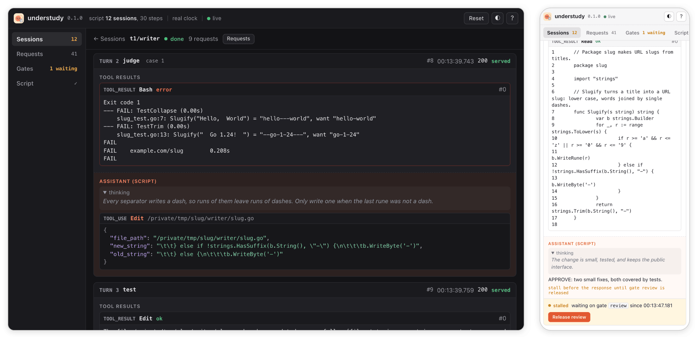

<p align="center">
  
</p>

<h1 align="center">understudy</h1>

<p align="center"><b>Fake AI models for coding agents: save tokens and make agent tests deterministic.</b></p>

## What it is

Coding agents such as Claude Code, Codex CLI, opencode, pi, Gemini CLI and Antigravity's CLI
talk to a model over an API. understudy plays that model from a short YAML script: you say what
the model answers at each turn, point the real agent at understudy, and the agent reads files,
runs commands, retries and streams exactly as it always does. No real model and no real
credentials are involved, so a test of anything that drives a coding agent is fast and gives the
same result every time. It can also play errors, stalls, dropped connections and usage limits,
each the way the real API sends them.

<p align="center">
  <a href="docs/screenshots/hero-divergence.png"></a>
</p>

## Quick start

```sh
go install github.com/seungduk/understudy/cmd/understudy@latest

cat > hello.yaml <<'YAML'
schema: understudy/v1
sessions:
  default:
    steps:
      - name: answer
        reply: {message: {text: "Hello from the understudy."}}
YAML

understudy serve --script hello.yaml &         # web UI at http://127.0.0.1:8765/_understudy/ui/
eval "$(understudy env)"                       # points Claude Code at it, with a dummy key only
claude -p "say hi" </dev/null                  # prints: Hello from the understudy.
understudy explain --url http://127.0.0.1:8765 # which step answered each request, and why
```

Scripts can also call tools, branch on test results, retry and fail: [SCRIPTS.md](SCRIPTS.md) is
the one-page guide, and `understudy validate FILE` checks a script with fix-it messages.

## Use with other harnesses

`understudy setup` writes the harness's config into a new, empty home folder and prints the
command that runs it against understudy, with dummy keys only (`--session KEY` names the session).

| Harness | Set up with |
|---|---|
| Claude Code | `eval "$(understudy env)"` |
| OpenAI Codex CLI | `understudy setup --harness codex --home /tmp/h` |
| opencode | `understudy setup --harness opencode --home /tmp/h` |
| pi | `understudy setup --harness pi --home /tmp/h` |
| Gemini CLI | `understudy setup --harness gemini-cli --home /tmp/h` |
| Antigravity CLI | `understudy setup --harness antigravity --home /tmp/h` |

Protocols, what each setup writes, and the versions tested: [docs/harnesses.md](docs/harnesses.md).

## Web UI and MCP

`understudy serve` also serves a live web UI at `/_understudy/ui/`: every session and its state,
each conversation with the step that answered it, divergences, gates to release, and the script
([more](docs/web-ui.md)). `understudy mcp` gives agents the same through MCP tools: write, check
and load a script, run the real CLI, read the log, release gates
([more](docs/mcp.md)).

<table>
  <tr>
    <td width="50%" valign="top"><a href="docs/screenshots/sessions.png"></a><br><sub><b>Sessions</b>: state, turn, step and counts; release a held gate</sub></td>
    <td width="50%" valign="top"><a href="docs/screenshots/requests.png"></a><br><sub><b>Requests</b>: the whole log, with any request open beside it</sub></td>
  </tr>
  <tr>
    <td width="50%" valign="top"><a href="docs/screenshots/conversation.png"></a><br><sub><b>A session</b>: the prompt, the scripted answers and the tool results</sub></td>
    <td width="50%" valign="top"><a href="docs/screenshots/script.png"></a><br><sub><b>Script</b>: the loaded YAML, with how many requests each step answered</sub></td>
  </tr>
  <tr>
    <td colspan="2"><a href="docs/screenshots/dark-mobile.png"></a><br><sub><b>Dark mode and phones</b>: a writer's fix loop, and a reviewer held at a gate</sub></td>
  </tr>
</table>

## Learn more

- [SCRIPTS.md](SCRIPTS.md): the script format, every field, complete examples
- [What understudy does](docs/features.md): wire protocols, faults, recording, the Go helpers
- [Harnesses](docs/harnesses.md): setup per harness and the versions tested
- [Faults and usage limits](docs/limits.md): what each harness does with each, measured
- [Record and replay](docs/recording.md) · [Go library](docs/go.md) · [Control API](docs/control-api.md)
- [Web UI](docs/web-ui.md) · [MCP](docs/mcp.md) · [Tests](docs/testing.md) · [Architecture](docs/ARCHITECTURE.md)
- [Learned from](docs/credits.md) · [Contributing](CONTRIBUTING.md)

## License

Apache-2.0. "Claude" and "Anthropic" are trademarks of Anthropic; "OpenAI" and "Codex" of OpenAI;
"Gemini" and "Antigravity" of Google; "DeepSeek" of DeepSeek. understudy is not affiliated with or
endorsed by any of them.
