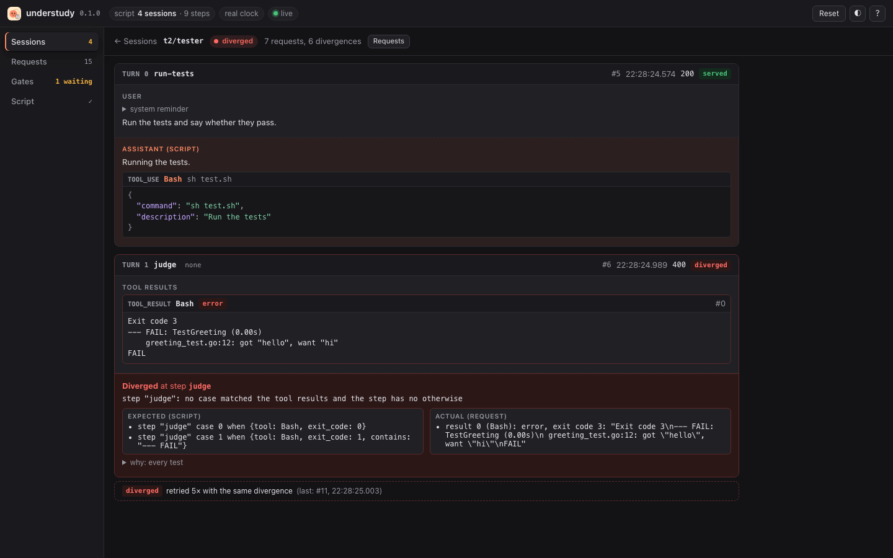
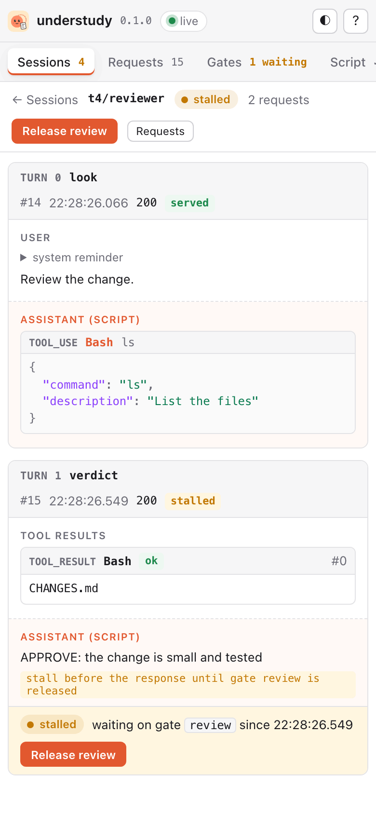

<p align="center">
  
</p>

<h1 align="center">understudy</h1>

<p align="center"><em>An understudy learns the lead's part and plays it exactly when asked.</em></p>

<p align="center">
  
</p>

A small, exact, scriptable fake of the model APIs that agent harnesses use, so the **real**
harness runs end to end with only the model faked. Claude Code, OpenAI's Codex CLI, opencode,
pi, Gemini CLI and Google Antigravity's CLI read and edit real files, run real commands, retry
and stream as they always do; understudy plays the model from a script. Use it for
deterministic tests of agent factories, harnesses and anything else that drives a coding agent.

- **Four wire protocols, exactly**: Anthropic Messages (the SSE event sequence, thinking with
  signatures, `input_json_delta`, in-stream errors, the subscription limit headers), OpenAI Chat
  Completions (`chat.completion.chunk` with `tool_calls` deltas, `reasoning_content`), OpenAI
  Responses (the typed `response.*` events Codex consumes, reasoning items, function and custom
  tool calls, `response.failed`) and Gemini (`generateContent`, `streamGenerateContent?alt=sse`,
  `functionCall`/`functionResponse` parts, `RESOURCE_EXHAUSTED` quota details), with each one's
  real error bodies and statuses.
- **One script for every harness**: neutral actions (`shell`, `read`, `write`, `edit`) become
  each harness's own tools (`Bash`, `exec_command`, `apply_patch`, `run_shell_command`, ...);
  native calls are sent as written. Each harness's results are read by its profile (how it
  reports exit codes and errors, measured on the real CLI).
- **Scripts agents can write**: YAML with a JSON Schema, closed sets of reply kinds and tests,
  unknown fields refused, plain fix-it errors with path, line and rule
  ([SCRIPTS.md](SCRIPTS.md) is the one-page guide).
- **Stateless and concurrent**: each request's turn is read from the conversation it carries, so
  many sessions run at once and client retries are safe. Sessions are keyed explicitly by a
  header or a prompt marker.
- **Faults**: HTTP errors, in-stream errors, stalls (timed, or held until a gate is released),
  mid-stream disconnects, TCP resets, slow streams, and usage limits in each protocol's form
  (Claude Code's `You've hit your weekly limit`, Codex's `You’ve hit your usage limit`, Gemini's
  quota errors).
- **Record and replay**: turn a real session (a Claude Code transcript, or live traffic of any
  harness through the recording proxy) into a script, then replay it with a strict or lenient
  divergence policy.
- **Go library and test helpers**: start the server inside `go test`, load scripts, drive any of
  the real CLIs, assert on the request log, release gates, move a virtual clock.
- **Web UI**: sessions and their state, each conversation with the step that answered every
  request, divergences with what was expected beside what came, gates to release, the script
  with the steps that ran, live.
- **MCP server** (`understudy mcp`): agents write, check and load scripts, run the real CLI,
  read the log, release gates and record transcripts through tools.
- Two dependencies (`gopkg.in/yaml.v3` and the official MCP Go SDK), Apache-2.0. How the code
  is layered: [docs/ARCHITECTURE.md](docs/ARCHITECTURE.md).

## Supported harnesses

| Harness | Protocol(s) understudy serves it | Tested version | Session key | e2e (2026-11-18, macOS arm64) |
|---|---|---|---|---|
| Claude Code | Anthropic Messages | 2.1.325 (2.1.326 on Linux) | header | 11 tests pass |
| OpenAI Codex CLI | OpenAI Responses (Codex dropped Chat Completions) | codex-cli 0.170.0 | header | 7 of 7 |
| opencode | Chat Completions, Anthropic Messages, DeepSeek provider | 1.19.6 | header | 7 of 7 per protocol |
| pi coding agent | Chat Completions, Responses, Anthropic Messages, Gemini | 0.73.1 | header | 7 of 7 per protocol |
| Gemini CLI | Gemini | 0.68.0 | header (`GEMINI_CLI_CUSTOM_HEADERS`) | 7 of 7 |
| Google Antigravity CLI (`agy`) | Gemini (`modelProvider: gemini`) | 1.5.11 | prompt marker | 7 of 7 |
| DeepSeek API users | Chat Completions at `/chat/completions`, Anthropic at `/anthropic/v1/messages` | (no official DeepSeek harness exists) | as the harness | opencode's `deepseek` provider: 7 of 7; Claude Code at `/anthropic`: covered |

The seven e2e tests per harness: a text answer, a tool loop that edits a real file, a branch on
a failing test, a retry after a server error, the usage-limit message, a stall held until a gate
is released, and record-then-replay through the recording proxy.

DeepSeek has no official coding harness (its own documentation points Claude Code at
`https://api.deepseek.com/anthropic` and lists opencode); understudy serves both DeepSeek
surfaces: Chat Completions without `/v1` (DeepSeek's base URL), thinking as DeepSeek's
`reasoning_content`, and the Anthropic API under `/anthropic`.

## Quick start

```sh
go install github.com/seungduk/understudy/cmd/understudy@latest

cat > hello.yaml <<'YAML'
schema: understudy/v1
sessions:
  default:
    steps:
      - name: answer
        reply: {message: {text: "Hello from the understudy."}}
YAML

understudy validate hello.yaml
understudy serve --script hello.yaml &          # http://127.0.0.1:8765, web UI at /_understudy/ui/
eval "$(understudy env)"                        # ANTHROPIC_BASE_URL + a dummy key, nothing real
claude -p --output-format stream-json --verbose "say hi" </dev/null
understudy explain --url http://127.0.0.1:8765  # which step answered each request, and why
```

Open <http://127.0.0.1:8765/_understudy/ui/> to watch it.

`understudy env` prints `export`/`unset` lines: it points `ANTHROPIC_BASE_URL` at the server,
sets a dummy `ANTHROPIC_API_KEY`, turns off telemetry and non-essential traffic, and removes any
variable that could carry a real credential. Run the CLI with its own empty `CLAUDE_CONFIG_DIR`
so it never reads your login. understudy never needs or forwards a real credential, and the
request log never keeps `Authorization`, `x-api-key` or any header that looks like a secret.

### Other harnesses

`understudy setup` writes a harness's config files into an empty home folder and prints the
command that runs it against the server, in an empty environment with dummy keys only:

```sh
understudy setup --harness codex --home /tmp/codex-home --session t1/writer --prompt "fix the bug"
# env -i PATH=... HOME=/tmp/codex-home CODEX_HOME=/tmp/codex-home/.codex UNDERSTUDY_DUMMY_KEY=understudy-dummy-key \
#   codex exec --json --skip-git-repo-check --dangerously-bypass-approvals-and-sandbox -C ... 'fix the bug' </dev/null
understudy harnesses          # every profile: protocols, how each action maps to its tools
```

What it sets up, per harness (never your own config: the home folder is new):

| Harness | Points it at understudy with | Runs |
|---|---|---|
| Codex | `config.toml`: `model_providers.understudy` with `base_url = "URL/v1"`, `wire_api = "responses"`, `env_key` naming a dummy key, `http_headers` with the session | `codex exec --json --skip-git-repo-check --dangerously-bypass-approvals-and-sandbox` with stdin empty (it reads more prompt from a pipe) |
| opencode | `OPENCODE_CONFIG` file: an `@ai-sdk/openai-compatible` provider with `baseURL = URL/v1`, the built-in `anthropic` and `deepseek` providers with `baseURL`, headers with the session, permissions allowed | `opencode run --format json --model understudy/fake-chat` (or `anthropic/fake-claude`, `deepseek/deepseek-chat`) |
| pi | `PI_CODING_AGENT_DIR/models.json`: one provider per API (`openai-completions`, `openai-responses`, `anthropic-messages`, `google-generative-ai`) with `baseUrl` and headers | `pi -p --mode json --model us-chat/fake-chat` (or `us-responses/...`, `us-anthropic/...`, `us-gemini/...`) |
| Gemini CLI | `GOOGLE_GEMINI_BASE_URL=URL`, `GEMINI_API_KEY` dummy, `settings.json` with `selectedType: gemini-api-key` and folder trust off, `GEMINI_CLI_CUSTOM_HEADERS` with the session | `gemini -p ... --output-format stream-json --yolo --model gemini-3.1-pro-preview` |
| Antigravity | `settings.json` with `modelProvider: gemini` (without it `GEMINI_API_KEY` is ignored), `GOOGLE_GEMINI_BASE_URL=URL`, `AGY_CLI_DISABLE_AUTO_UPDATE` | `agy -p ... --output-format stream-json --dangerously-skip-permissions`; the session marker goes into the prompt |

Side requests are answered without the script and logged with `aux`: opencode's title request,
Gemini CLI's routing request (sent when no `--model` is given).

## Scripts

```yaml
schema: understudy/v1
sessions:
  t2/writer:                       # session key: header X-Understudy-Session, or [understudy-session: KEY] in the prompt
    steps:
      - name: test                 # step 1 answers turn 1
        reply:
          tool_use:
            calls: [{tool: Bash, input: {command: "go test ./...", description: Run the tests}}]
      - name: judge                # step 2 answers the request that carries the test result
        cases:
          - when: {tool: Bash, exit_code: 0}
            reply: {message: {text: "DONE: tests pass"}}
          - when: {tool: Bash, result: error, contains: FAIL}
            next: test             # fix, then test again
            reply:
              tool_use:
                calls: [{tool: Write, input: {file_path: "{{cwd}}/fix.go", content: "package main\n"}}]
```

Replies: `message`, `tool_use`, `http_error`, `stream_error`, `limit`. Tests on tool results:
`tool`, `result` (ok/error), `exit_code`, `contains`, `regex`. Retries at one turn: `attempts`.
Faults on any reply: `stall`, `cut`, `pace`. The full format, every field, and five complete
examples are in [SCRIPTS.md](SCRIPTS.md); the JSON Schema is
[script/understudy-v1.schema.json](script/understudy-v1.schema.json) (`understudy schema`).

`understudy validate FILE --json` prints `{ok, file, sessions, problems: [{path, line, rule,
message, fix}]}`; the exit code is 0 when the script checks.

## Faults

What each harness did with each fault (measured 2026-11-18 with the versions above):

| Script | Codex | opencode | pi | Gemini CLI | Antigravity |
|---|---|---|---|---|---|
| `http_error: {error: api_error}` | retried | retried | retried | retried | **not retried**, exit 3 |
| `http_error: {error: overloaded}` | retried | retried | retried | retried | retried |
| `http_error: {error: rate_limit, retry_after_seconds: 1}` | retried | retried | retried | retried | retried |
| `stream_error: {error: overloaded}` | **not retried**: `Selected model is at capacity`, exit 1 | retried | retried | retried | kept the partial text as a turn and asked again |
| `cut: {after_events: 3, how: reset}` | retried (`Reconnecting... 1/5`) | retried | retried | retried | retried |
| `http_error: {error: invalid_request, retry: never}` | not retried, exit 1 | not retried, exit 1 | not retried, exit 0 | not retried | not retried, exit 3 |
| `limit: {window: per_minute}` | retried | retried after retry-after | retried | retried after RetryInfo | retried |
| `limit: {window: seven_day}` | `You’ve hit your usage limit`, exit 1 | waits out retry-after | 4 requests, then `429 The usage limit has been reached` | `You exceeded your current quota`, no retry | `RESOURCE_EXHAUSTED`, exit 3 |

Codex with a 500 that never ends sends 30 requests (6 stream attempts of 5 HTTP tries each)
before `We’re currently experiencing high demand`.

| Script | Wire | Claude Code 2.1.325 did |
|---|---|---|
| `http_error: {error: overloaded}` | 529 `overloaded_error` | retried (exit 0 when a later attempt answers) |
| `http_error: {error: api_error}` | 500 `api_error` | retried |
| `stream_error: {error: overloaded}` | 200, `message_start`, `ping`, `event: error` | retried the whole request |
| `cut: {after_events: 4, how: close}` | stream closed mid-way | retried |
| `cut: {after_events: 0, how: reset}` / `after_events: 3` | TCP RST before / during the stream | retried |
| `stall: {gate: g}` | the reply waits until `POST /_understudy/gates/g/release` | waited, then went on |
| `limit: {window: seven_day, ...}` | 429 with the unified headers (below) | `You've hit your weekly limit · resets <time>`, exit 1, no retry (gateway token) |
| strict divergence | 400 `invalid_request_error`, `x-should-retry: false` | retried 5 times, then `API Error: 400 understudy: the request does not fit the script: ...`, exit 1 |

## Account-limit simulation (measured)

### Codex, Gemini and the others

The same `limit` reply is each protocol's own limit:

- **OpenAI protocols** (Codex, opencode, pi): `429` with
  `{"error":{"type":"usage_limit_reached","resets_at":<unix>,"limit_window_minutes":N,...}}`,
  `x-codex-primary-used-percent: 100`, `x-codex-primary-window-minutes`, `x-codex-primary-reset-at`,
  `retry-after` and `x-should-retry: false`. Codex 0.170.0 parses it (in `codex-api`) as a usage
  limit and prints `You’ve hit your usage limit. ... try again at <time>.`, exit 1, no retry.
  Without `x-should-retry: false` the OpenAI SDK in pi sleeps for the whole `retry-after`.
  `per_minute` is a `429 rate_limit_exceeded` (`Please try again in Ns.`) that every harness retries.
- **Gemini** (Gemini CLI, Antigravity, pi): `429 RESOURCE_EXHAUSTED` with
  `google.rpc.QuotaFailure` (`quotaId` `GenerateRequestsPerDayPerProjectPerModel` for `daily`,
  `...PerMinute...` for `per_minute`) and `google.rpc.RetryInfo`. Gemini CLI 0.68.0 reads a
  per-day quota as terminal (`You have exhausted your daily quota on this model.`), a delay over
  300 s as terminal (`Suggested retry after 7200s`), and retries a shorter one after `retryDelay`.
- **Anthropic** to harnesses other than Claude Code (opencode, pi): the unified headers below;
  they show the body's message.

### Claude Code

Measured on 2026-11-18 with **Claude Code 2.1.325** (macOS arm64), against a probe server and then
the e2e suite:

- A 429 carrying these headers:

  ```
  x-should-retry: false
  retry-after: <seconds>
  anthropic-ratelimit-unified-status: rejected
  anthropic-ratelimit-unified-representative-claim: seven_day     (five_hour, seven_day_opus, seven_day_sonnet)
  anthropic-ratelimit-unified-reset: <unix seconds>
  anthropic-ratelimit-unified-7d-status: rejected                 (5h-* for five_hour)
  anthropic-ratelimit-unified-7d-reset: <unix seconds>
  anthropic-ratelimit-unified-7d-utilization: 1.0
  ```

  makes Claude Code print `You've hit your weekly limit · resets 10:37pm (Asia/Seoul)` (or
  `5-hour limit`, `Opus limit`), set `api_error: "usage_limit_reached"` on its result line, exit 1,
  and send no retry, **when it authenticates the way subscription and gateway accounts do**. It
  reads the unified headers only for claude.ai subscribers, or when `ANTHROPIC_BASE_URL` points
  somewhere other than `api.anthropic.com` and `ANTHROPIC_AUTH_TOKEN` is a JWT whose audience is
  `claude-gateway`. understudy's `--auth gateway` (`clienv.Gateway`) sends such a token: an
  unsigned JWT (`alg: none`) that nothing can verify, so it is not a credential.
- With a dummy API key, the same 429 is a plain rate limit:
  `API Error: Request rejected (429) · <message>`.
- Without `x-should-retry: false`, Claude Code retries the 429 (up to 10 times) in either mode.

Other measured facts (2.1.325): `claude -p` sends `HEAD /api/hello` at start even with
`ANTHROPIC_BASE_URL` set; each turn is one `POST /v1/messages?beta=true` with `stream: true`; the
conversation carries a `role: "system"` message holding `Primary working directory: <cwd>` (which
`{{cwd}}` uses); a failed Bash call comes back as `is_error: true` with `Exit code N` first; an Edit
without permission comes back as an error, so scripted runs pass `--dangerously-skip-permissions`;
`ANTHROPIC_CUSTOM_HEADERS` reaches every request; `--append-system-prompt` reaches the `system`
field.

## Record and replay

```sh
# a real session's transcript -> a script (tool inputs rebased on {{cwd}})
claude -p --output-format stream-json --verbose "fix the bug" > run.jsonl
understudy record --transcript run.jsonl --session t1/writer --run r42 --task t1 --seat writer \
  --recorded-at 2026-11-18T09:30:00Z --out t1-writer.yaml

# or record live traffic: forward to the real API, write the script on Ctrl-C
understudy record-proxy --upstream https://api.anthropic.com --addr 127.0.0.1:8766 --out rec.yaml
```

`record-proxy` speaks every protocol: point any harness's base URL at it and it records the
session through the request's codec, with the harness's native tool calls (a script of a harness
other than Claude Code names its `harness:`, schema `understudy/v2`). The e2e suite records each
harness through it against a scripted upstream and replays the result.

`record --transcript` reads two forms: the `stream-json` output of `claude -p --output-format
stream-json --verbose`, and a Claude Code session file (`~/.claude/projects/*/*.jsonl`). A tool
that keeps sessions in its own log extracts the session records into one of these first.
Subagent records are left out with a note.

A recorded script is an ordinary script, with `provenance` (source, run, task, seat, Claude Code
session id, time, CLI version). Each step `expect`s the outcome the recording saw (ok, or the
error and its exit code), so a replay whose tool results differ stops at the first divergence
(`divergence: strict`) or logs it and goes on (`lenient`). Retries the client made are recorded
as `attempts`; the usage-limit message becomes a `limit` reply. In Go: `record.FromTranscript`
and `record.NewProxy`. The proxy forwards credentials to the upstream and never stores them.

## Go

```go
o := us.Harness(t, fake, harness.Codex, us.HarnessRun{Dir: dir, Session: "t1/writer", Prompt: "fix it"})
// o.Exit, o.Stdout, o.Stderr, o.Version, o.Home; Protocol: protocol.Gemini picks pi's Gemini provider
```

`us.Harness` runs any profiled harness from its launch data (a fresh home folder, an empty
environment but `PATH`, dummy keys) and skips the test when the binary is missing
(`UNDERSTUDY_CODEX`, `UNDERSTUDY_OPENCODE`, `UNDERSTUDY_PI`, `UNDERSTUDY_GEMINI`, `UNDERSTUDY_AGY`
name other binaries). For Claude Code:

```go
import us "github.com/seungduk/understudy/understudytest"

func TestWriterSeat(t *testing.T) {
	fake := us.Start(t, us.ScriptFile("testdata/writer.yaml"))  // or us.YAML(...), us.Script(s), us.VirtualClock(t0)
	dir := us.TempDir(t, map[string]string{"greeting.txt": "hello world\n"})
	run := us.Claude(t, fake, us.Run{Dir: dir, Session: "t1/writer", Prompt: "change the greeting"})
	// run.Exit, run.Result, run.IsError, run.Events (stream-json), run.Version
	// fake.Messages() is the request log: session, turn, step, branch, attempt, outcome, trace
	// fake.Release("gate"), fake.WaitGate("gate", 1, time.Minute), fake.Advance(d), fake.Reset()
}
```

`us.Claude` runs `claude -p --output-format stream-json --verbose` with a fresh
`CLAUDE_CONFIG_DIR`, dummy credentials (`Auth: clienv.APIKey` or `clienv.Gateway`) and
`--dangerously-skip-permissions`; it skips the test, saying why, when `claude` is not installed
(`UNDERSTUDY_CLAUDE` names another binary). The server alone is `server.New(server.Options{...})`,
an `http.Handler`. See [examples/go/writer_test.go](examples/go/writer_test.go).

## Web UI

`understudy serve` answers a web UI at `/_understudy/ui/` on the same address (`--ui off` turns it
off). It is a thin page over the control API below: no build step to run, nothing loaded from
the network, assets embedded in the binary, live through Server-Sent Events.

- **Sessions**: every session the script names or the log has seen, with its state: `idle`,
  `waiting` (the client owes the next request), `streaming`, `stalled` (held at a gate, with a
  Release button), `diverged` or `done`; its turn, the step that answered, and counts.
- **A session** reads as a conversation: the prompt (Claude Code's system reminders folded), the
  tool results each request carried, and what the script answered (thinking, text, tool calls
  with their inputs, HTTP and in-stream errors, usage limits, stalls and cuts), each turn labelled
  with the step and case that answered it. Retries of a refused request fold into one line.
- **Divergences** are red, with what the script expected beside what the request carried and
  every test that ran.
- **Requests**: the whole log, filtered by text, session, outcome or divergences only, with a
  detail pane (trace, tool results, earlier turns, headers).
- **Gates** with who waits on them; **Script**: the loaded YAML, highlighted, with how many
  requests each step answered (red where one diverged); Edit checks a new script as you type
  and loads it.

Keyboard: `1`-`4` switch views, `j`/`k` move, `Enter` opens, `Esc` goes back, `/` filters, `r`
releases the gate of the selected session, `t` switches light and dark, `?` lists the keys.

<p>
  
  
</p>
<p>
  
  
</p>
<p>
  
  
</p>

The screenshots are real sessions of Claude Code 2.1.325 against `understudy serve`: a tool loop
that edits a file, a test result no case expected, a 529 then the weekly limit, and a reviewer
held at a gate (released from the UI, after which Claude Code printed the scripted verdict).

## MCP

`understudy mcp` is an MCP server over stdio for agents (built on the official
[Go SDK](https://github.com/modelcontextprotocol/go-sdk)). It acts on the understudy server at
`--url` (default `http://127.0.0.1:8765`) and starts one there when none answers
(`--server auto`, the default; `attach` only uses a running one; `start` always starts one). A
server it starts also has the web UI, and stops with it. `understudy serve` also answers MCP
over streamable HTTP at `/_understudy/mcp` (`--mcp off` turns it off).

| Tool | Does |
|---|---|
| `validate_script` | check a script (`yaml` or `file`) without loading it: `{ok, sessions, problems: [{path, line, rule, message, fix}]}` |
| `load_script` | load a script into the server; one that does not check is refused with its problems |
| `client_env` | the environment and command that run the real `claude -p` against the server, dummy credentials only (`session`, `auth: api_key \| gateway`); with `harness` (`codex`, `opencode`, `pi`, `gemini-cli`, `antigravity`, and `protocol`, `dir`) that harness's command, its config written into a fresh home |
| `list_sessions` | every session with its state, turn, step and counts, and the gates |
| `read_log` | the request log, filtered by `session`, `outcome` (or `divergence`), `step`, `since_seq`, `limit`; `detail: summary \| full` |
| `explain` | why each request got its answer, what a divergence expected and got; with `script_yaml` or `script_file`, what that script would choose instead |
| `release_gate` | let requests held by `stall: {gate: NAME}` go on |
| `reset` | forget the log, retry counts and gates; the script stays |
| `record` | a real session's transcript into a script (`then: load` also loads it) |

Resources: `understudy://docs/SCRIPTS.md` (the script guide) and
`understudy://schema/understudy-v1.schema.json`. Every answer is JSON; a failed call is an error
result `{ok: false, error, fix}`, with `problems` for a script that does not check and the shape
of the arguments for arguments that do not fit.

Claude Code (or `.mcp.json` in a project, with the same `command` and `args`):

```sh
claude mcp add understudy -- understudy mcp
```

Codex (`~/.codex/config.toml`):

```toml
[mcp_servers.understudy]
command = "understudy"
args = ["mcp"]
```

Cursor (`.cursor/mcp.json`), or any client that speaks streamable HTTP to a running
`understudy serve`:

```json
{ "mcpServers": { "understudy": { "command": "understudy", "args": ["mcp"] } } }
```

```json
{ "mcpServers": { "understudy": { "url": "http://127.0.0.1:8765/_understudy/mcp" } } }
```

The loop an agent runs: read the guide resource, write a script, `validate_script`,
`load_script`, `client_env` for the session, run the command it gives in the working folder,
then `list_sessions` and `read_log` with `outcome: divergence` (or `explain`) to see where the
run left the script; fix it, `load_script`, `reset`, run again.

## Control API

On the same address, under `/_understudy/`:

| Call | Does |
|---|---|
| `GET health` | `{ok, version, script_loaded}` |
| `PUT script` (body: the YAML) | load a script; `400 {problems: [...]}` when it does not check (or names a harness without a profile) |
| `GET script` | the loaded script, as it was written |
| `GET script/info` | `{loaded, divergence, provenance, sessions: [{key, line, steps: [{name, line}]}]}` |
| `POST validate` (body: the YAML) | `{ok, sessions, problems}` without loading it |
| `GET sessions` | every session: `{key, state, turn, step, branch, requests, divergences, gate, ...}` |
| `GET requests[?session=KEY]` | the request log: per request also the `prompt`, the `answer` sent, `held` while stalled, and `expected`/`actual` for a divergence |
| `GET events` | Server-Sent Events: `change` with `{"version": N}` after every change of the log, gates or script |
| `POST reset` | forget the log, attempt counts and gates (waiting requests are released) |
| `GET gates`, `POST gates/NAME/release` | gates and who waits on them |
| `GET clock`, `POST clock/advance {"ms": N}` | the virtual clock (`serve --clock virtual`) |

## Tests

```sh
go test -race ./...                  # unit and package tests, no network beyond loopback
go test -tags e2e -v ./e2e           # drives the real CLIs (each skips if it is not installed)
UNDERSTUDY_HARNESS=codex,pi go test -tags e2e -run TestHarness -v ./e2e   # some harnesses only
(cd ui && npm ci && npm run check && npm run build)   # the web UI: type-check and build into ui/dist
```

The built UI (`ui/dist`) is committed so `go install` needs no Node; CI rebuilds it and fails when
it differs from the sources (`ui/web`).

The e2e suite covers text, a tool loop editing a real file, branching on a failing test, retry
after 529, an in-stream error, close and reset mid-stream, a gated stall released by the test, the
weekly and 5-hour limit messages, the system-prompt session marker, strict divergence, record
then replay (passing, then diverging), and the MCP loop (load a script, run the CLI with
`client_env`, find the divergence with `read_log`, fix, reset, run again).

Each codec runs the shared contract (`internal/protocol/codectest`): every reply shape, error
kind, retry hint and limit window round-trips through its encoder and its reader. The harness
profiles' result rules are tested on the exact texts each real CLI sent.

The e2e suite covers text, a tool loop editing a real file, branching on a failing test, retry
after 529, an in-stream error, close and reset mid-stream, a gated stall released by the test, the
weekly and 5-hour limit messages, the system-prompt session marker, strict divergence, and record
then replay (passing, then diverging).

### In an agent factory

understudy ran a whole practice run of an agent factory on four machines on 2026-11-18:
the real Claude Code 2.1.325 in microVMs on three Macs, every seat (planner, writer,
reviewer, merger) scripted by task and seat (`X-Understudy-Session: F-1/writer`), with the server
on a fourth machine. Two tasks were planned, written (real edits through scripted Read/Edit calls),
checked, reviewed and landed; their writers were held at a gate until both had written, so the
second landing conflicted and the scripted merger resolved it; one planner request got the
weekly limit, which the factory read as that machine's limit and moved the seat to another
machine. 19 requests, all served, none diverged.

### Harness versions tested

| Harness | Version | Installed from | Result | Date |
|---|---|---|---|---|
| Codex CLI | 0.170.0 | npm `@openai/codex` | 7/7 | 2026-11-18 |
| opencode | 1.19.6 | npm `opencode-ai` | 7/7 over Chat Completions, Anthropic and its DeepSeek provider | 2026-11-18 |
| pi | 0.73.1 | npm `@mariozechner/pi-coding-agent` | 7/7 over Chat Completions, Responses, Anthropic and Gemini | 2026-11-18 |
| Gemini CLI | 0.68.0 | npm `@google/gemini-cli` | 7/7 | 2026-11-18 |
| Antigravity CLI | 1.5.11 | Google's release tarball (the Homebrew cask's URL and checksum) | 7/7 | 2026-11-18 |

All were installed into a private prefix, run with fresh home folders and dummy keys, and never
signed in.

### Claude Code versions tested

| Version | Platform | Result | Date |
|---|---|---|---|
| 2.1.325 | macOS 27 arm64 | e2e suite passes (11 tests) | 2026-11-18 |
| 2.1.325 | macOS 27 arm64 | e2e suite passes (12 tests, with the MCP loop and the web UI's log fields) | 2026-11-18 |
| 2.1.326 | Linux x86_64 | e2e suite passes (11 tests) | 2026-11-18 |
| 2.1.325 | Linux arm64 microVMs on macOS | a full agent-factory practice run, 19 requests | 2026-11-18 |

### Scripts written by agents

The guide is tested on agents. Fresh agents get [SCRIPTS.md](SCRIPTS.md) and
[e2e/guide-tasks.md](e2e/guide-tasks.md) and nothing else, write five scripts blind (text only, a
tool loop that edits a file, a branch on a check, the weekly limit, a stall released by a gate),
and `UNDERSTUDY_GUIDE_DIR=<their folder> go test -tags e2e -run TestGuide ./e2e` runs each with the
real CLI. Round 1 (2026-11-18): Claude Opus and Claude Haiku each passed 4 of 5; both missed that
Claude Code reports a lone `test -f` exiting 1 as a success. The guide now has a table of what
Claude Code sends back for each tool; round 2: Claude Opus 5/5, Claude Haiku 5/5 and Codex
(codex-cli 0.167.0) 5/5, each on the first try.

### The MCP server, used by agents

Fresh agents got this README and the MCP config (`understudy mcp --url ... --server attach`
against their own `understudy serve`) and nothing else, on 2026-11-18, with Claude Code 2.1.325
as the CLI under test:

- **Find and fix a divergence**: script a check (`test -f done.txt || exit 1`) that the next step
  expects to pass, run the real `claude -p` in a folder without the file, find the divergence
  with the tools, fix the script to answer both outcomes, reset and run again until the result is
  `NOT DONE` and the session is `done`. Claude Code (Opus) and Codex (codex-cli 0.167.0) each
  passed on the first try (Claude used `read_log` with `outcome: divergence`, then `explain` with
  the edited script before loading it; Codex used `explain`).
- **Stall and release, then record**: hold a final answer at a gate, run the CLI in the
  background, show the session `stalled` on the gate with `list_sessions`, `release_gate`, see
  `APPROVED`, and `record` the run's transcript. Both passed on the first try.

The server's own log after each run was checked, not only the agents' reports. Every run used
the dummy credentials `client_env` gives.

## Learned from

understudy takes ideas, not code, from these projects (all MIT or Apache-2.0); see [NOTICE](NOTICE).

- [AkaraChen/fakellm](https://github.com/AkaraChen/fakellm): the event sequence and where `ping`
  goes, measured Claude Code retry behaviour (`docs/wire.md`), reading the conversation position
  from the request history so retries and concurrency are safe, close versus reset cuts, the
  request-log record.
- [majorcontext/harness](https://github.com/majorcontext/harness) (`harnesstest`): named steps and
  block/release gates for deterministic stalls.
- [acus9345/mock-llm-server](https://github.com/acus9345/mock-llm-server): the small reply model
  (text, reasoning, tool calls, error, stream error).
- [piyook/llm-mock](https://github.com/piyook/llm-mock), [theblixguy/llm-mock-server](https://github.com/theblixguy/llm-mock-server),
  [kagent-dev/mockllm](https://github.com/kagent-dev/mockllm): fault and matching vocabularies.
- [sloprail/harness-mocks](https://github.com/sloprail/harness-mocks): a corpus of recorded real
  Claude Code runs (a fake CLI, the opposite approach: it replaces the CLI, understudy keeps it).

What understudy adds: an explicit session key, closed reply kinds and tests instead of free-form
regex rules and embedded scripting, event-gated stalls, the measured subscription-limit
simulation, and record/replay with a divergence policy.

## License

Apache-2.0. "Claude" and "Anthropic" are trademarks of Anthropic; "OpenAI" and "Codex" of OpenAI;
"Gemini" and "Antigravity" of Google; "DeepSeek" of DeepSeek. understudy is not affiliated with or
endorsed by any of them.
