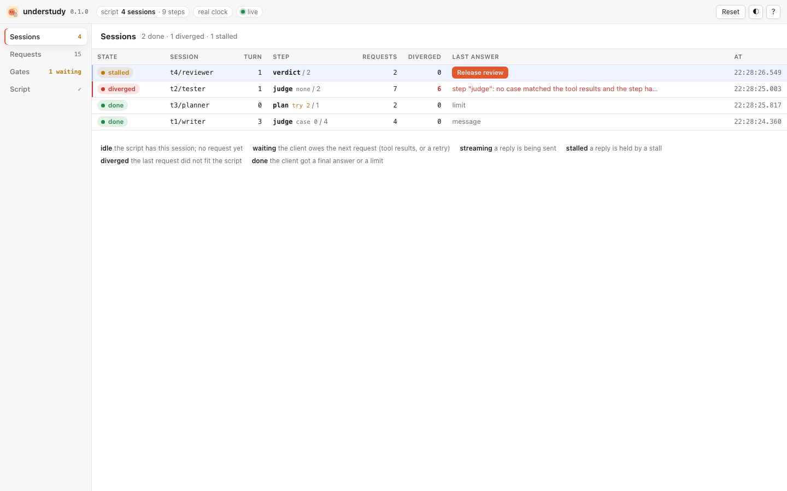

<p align="center">
  
</p>

<h1 align="center">understudy</h1>

<p align="center"><b>A fake AI model for coding agents: save tokens and make agent tests deterministic.</b></p>

<p align="center">
  <a href="https://pkg.go.dev/github.com/seungduk/understudy"></a>
  <a href="https://github.com/seungduk/understudy/actions/workflows/ci.yml"></a>
  <a href="https://github.com/seungduk/understudy/releases/latest"></a>
  <a href="LICENSE"></a>
</p>

<p align="center">
  <b>English</b> | <a href="README.ko.md">한국어</a> | <a href="README.ja.md">日本語</a> | <a href="README.zh-CN.md">简体中文</a>
</p>

## What it is

Coding agents such as Claude Code and Codex send each request to an AI model over an HTTP API. **understudy** is a fake model: a local server that answers those requests from a short YAML script. You write what the fake model says at each step, point the agent at understudy, and then run your real agent. Only the model is fake: the agent reads and edits files, runs commands, retries, and streams replies as it always does.

Your agent tests then need no API key, spend no tokens, and give the same result on every run. The fake model can also answer with HTTP errors, stalls, dropped connections, and usage limits, with the same error bodies and status codes the real APIs send. [docs/limits.md](docs/limits.md) shows what each agent did with each fault when we measured it.

<p align="center">
  <a href="docs/screenshots/hero-divergence.png"></a>
</p>

## Example: test that the agent edits a file

In [examples/2-edit-file.yaml](examples/2-edit-file.yaml), the fake model tells the agent to read `greeting.txt` and then replace "hello" with "goodbye". This Go test runs the real Claude Code against a copy of that script in `testdata/edit.yaml` and checks the file on disk:

```go
func TestAgentEditsTheFile(t *testing.T) {
	fake := us.Start(t, us.ScriptFile("testdata/edit.yaml"))
	dir := us.TempDir(t, map[string]string{"greeting.txt": "hello world\n"})

	run := us.Claude(t, fake, us.Run{Dir: dir, Session: "t1/writer",
		Prompt: "Change the greeting to goodbye."})

	got, _ := os.ReadFile(filepath.Join(dir, "greeting.txt"))
	if run.Exit != 0 || string(got) != "goodbye world\n" {
		t.Fatalf("exit %d, greeting.txt is %q", run.Exit, got)
	}
}
```

`us` is `github.com/seungduk/understudy/understudytest` (add it with `go get github.com/seungduk/understudy/understudytest@latest`). The test is skipped when `claude` is not installed. [docs/go.md](docs/go.md) shows the same for the other agents.

## Install

Download the archive for your system (Linux, macOS or Windows; amd64 or arm64) from the
[latest release](https://github.com/seungduk/understudy/releases/latest), unpack it, and put `understudy` on your `PATH`. For example, on a Mac
with Apple silicon:

```sh
curl -fsSL https://github.com/seungduk/understudy/releases/download/v0.1.0/understudy_0.1.0_darwin_arm64.tar.gz | tar -xz understudy
./understudy version    # prints: understudy v0.1.0 (commit ...)
```

Each release lists the SHA-256 sums of its archives in `understudy_<version>_checksums.txt`
(check with `shasum -a 256 -c understudy_0.1.0_checksums.txt --ignore-missing`). If macOS
refuses to open a binary downloaded with a browser, run `xattr -d com.apple.quarantine understudy`.

Or build it with Go 1.25 or later:

```sh
go install github.com/seungduk/understudy/cmd/understudy@latest
```

You also need the agent you test, installed and on your `PATH`. The quick start uses Claude Code
(`claude`).

## Quick start

```sh
cat > hello.yaml <<'YAML'
schema: understudy/v1
sessions:
  default:
    steps:
      - name: answer
        reply: {message: {text: "Hello from the understudy."}}
YAML

understudy serve --script hello.yaml &         # web UI at http://127.0.0.1:8765/_understudy/ui/
eval "$(understudy env)"                       # Claude Code in this shell now uses understudy
claude -p "say hi" </dev/null                  # prints: Hello from the understudy.
understudy explain --url http://127.0.0.1:8765 # which script step answered each request, and why
```

`understudy env` unsets your real Anthropic keys in this shell only; open a new shell to use the real model again. Scripts can also call tools, branch on command output, and return errors: see [SCRIPTS.md](SCRIPTS.md). `understudy validate FILE` checks a script and says how to fix each problem.

## Words used here

- **Session**: one conversation in a script, named by a key such as `t1/writer`. The agent sends the key with each request; a request without one goes to the session `default`.
- **Step**: one scripted answer. Step 1 answers the session's first request, step 2 the next one, and so on.
- **Divergence**: a request the script did not expect. By default understudy answers it with an error and shows what the script expected beside what the agent sent.
- **Gate**: a named pause. A step with `stall: {gate: NAME}` holds its answer until you release the gate.

## Use with other agents

`understudy setup` writes the agent's config files into an empty folder that becomes the agent's home (`./agent-home` below), then prints the command that runs the agent against understudy with a dummy key. Add `--session KEY` to choose the session.

| Agent | Set up with |
|---|---|
| Claude Code | `eval "$(understudy env)"` |
| OpenAI Codex CLI | `understudy setup --harness codex --home ./agent-home` |
| opencode | `understudy setup --harness opencode --home ./agent-home` |
| pi | `understudy setup --harness pi --home ./agent-home` |
| Gemini CLI | `understudy setup --harness gemini-cli --home ./agent-home` |
| Antigravity CLI | `understudy setup --harness antigravity --home ./agent-home` |

[docs/harnesses.md](docs/harnesses.md) lists the API each agent speaks, the files `setup` writes, and the agent versions we tested.

## Web UI and MCP

`understudy serve` also serves a web UI at `/_understudy/ui/`. It shows each session's state, which step answered each request, each divergence, and the loaded script, and it has a button that releases a gate ([learn more](docs/web-ui.md)).

`understudy mcp` gives AI agents the same controls as Model Context Protocol (MCP) tools: they can write and check scripts, get the command that runs an agent against understudy, read the request log, and release gates ([learn more](docs/mcp.md)).

<table>
  <tr>
    <td width="50%" valign="top"><a href="docs/screenshots/sessions.png"></a><br><sub><b>Sessions</b>: each session's state, current step, and request counts; release a held gate here.</sub></td>
    <td width="50%" valign="top"><a href="docs/screenshots/requests.png"></a><br><sub><b>Requests</b>: every request the agent sent; open one to see it beside what the script expected.</sub></td>
  </tr>
  <tr>
    <td width="50%" valign="top"><a href="docs/screenshots/conversation.png"></a><br><sub><b>Session history</b>: the prompt, the fake model's scripted answers, and the tool results the agent sent back.</sub></td>
    <td width="50%" valign="top"><a href="docs/screenshots/script.png"></a><br><sub><b>Script</b>: the loaded YAML script, with how many requests each step has answered.</sub></td>
  </tr>
  <tr>
    <td colspan="2"><a href="docs/screenshots/dark-mobile.png"></a><br><sub><b>Phone and dark mode</b>: the web UI also works on narrow screens and in dark mode.</sub></td>
  </tr>
</table>

## Learn more

- [SCRIPTS.md](SCRIPTS.md): the script format, every field, and worked examples
- [Features](docs/features.md): APIs, faults, recording real traffic, and Go test helpers
- [Agents](docs/harnesses.md): how to set up each agent, and the versions tested
- [Faults and limits](docs/limits.md): what each agent did under API errors, stalls, and usage limits, as measured
- [Record and replay](docs/recording.md) · [Go library](docs/go.md) · [Control API](docs/control-api.md)
- [Web UI](docs/web-ui.md) · [MCP server](docs/mcp.md) · [Testing](docs/testing.md) · [Architecture](docs/ARCHITECTURE.md)
- [Credits and references](docs/credits.md) · [Contributing](CONTRIBUTING.md) · [Changelog](CHANGELOG.md) · [Security](SECURITY.md) · [Code of conduct](CODE_OF_CONDUCT.md)

## License

Apache-2.0. "Claude" and "Anthropic" are trademarks of Anthropic; "OpenAI" and "Codex" of OpenAI;
"Gemini" and "Antigravity" of Google; "DeepSeek" of DeepSeek. understudy is not affiliated with or
endorsed by any of them.
