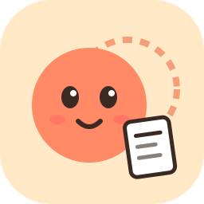
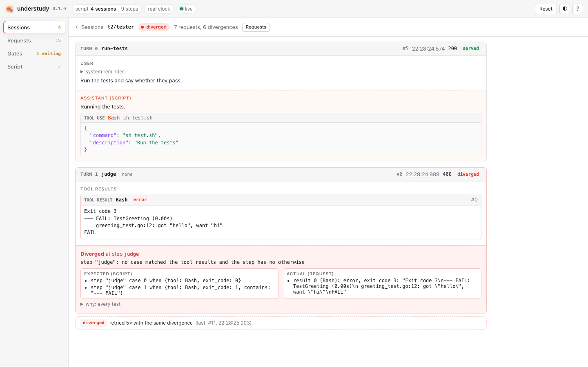
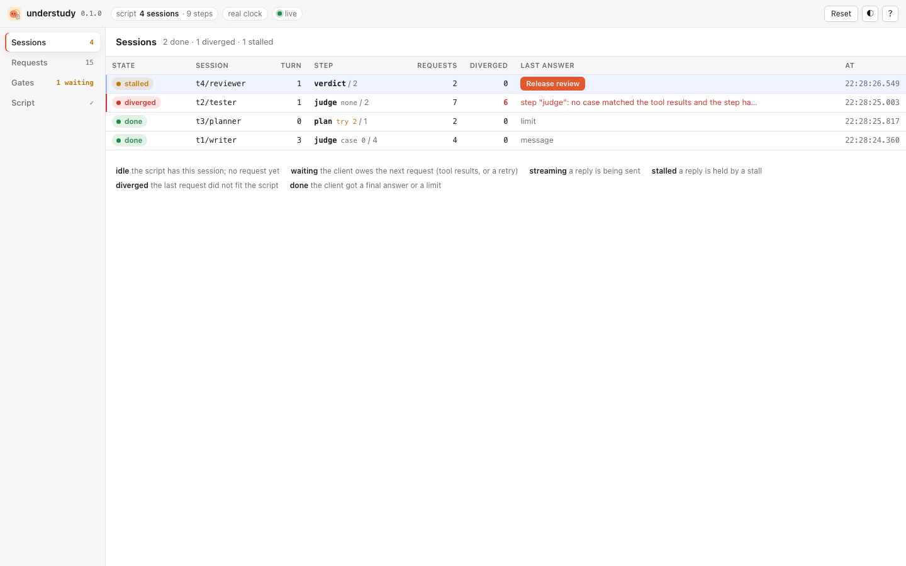
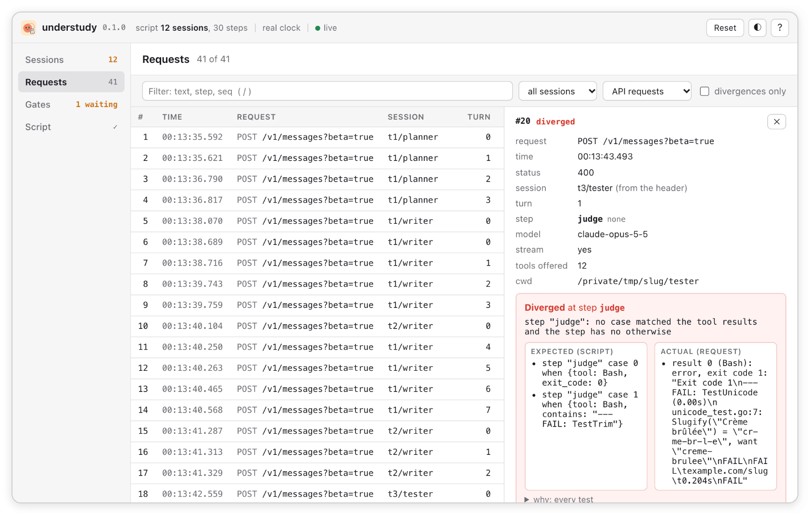
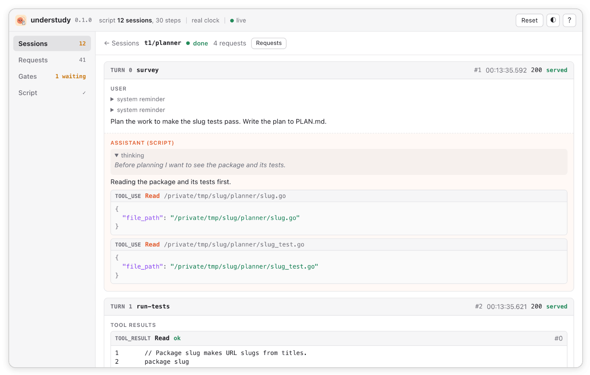
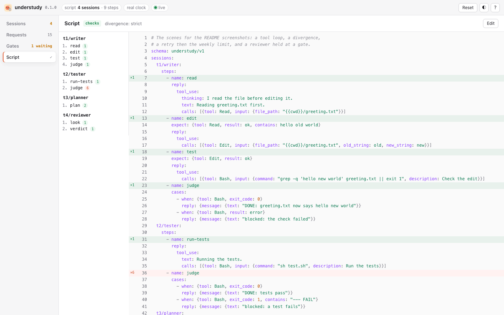
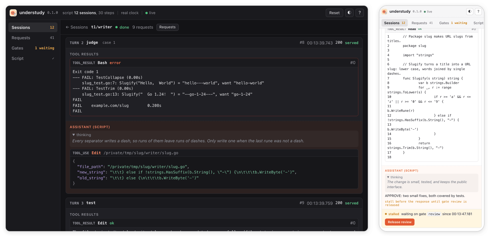

<p align="center">
  
</p>

<h1 align="center">understudy</h1>

<p align="center"><b>面向编程智能体的 Mock AI 模型：节省 Token 并实现 Agent 测试的确定性。</b></p>

<p align="center">
  <a href="README.md">English</a> | <a href="README.ko.md">한국어</a> | <a href="README.ja.md">日本語</a> | <b>简体中文</b>
</p>

## 项目简介

Claude Code、Codex CLI、opencode、pi、Gemini CLI 以及 Antigravity CLI 等编程智能体（Coding Agent）通过 HTTP API 与大语言模型通信。**understudy** 使用简洁的 YAML 脚本来 Mock 这些模型 API。你只需定义模型在每个回合中返回的内容，并将真实的 Agent 指向 understudy，Agent 即可像在生产环境中一样读取与编辑文件、运行终端命令、自动重试以及流式接收响应。

由于测试过程中不调用真实大模型且无需真实 API 凭据，Agent 测试套件可在数毫秒内完成，并保证每次运行结果完全一致（确定性）。此外，understudy 还可以模拟 HTTP 错误、请求挂起（stall）、连接断开以及用量限制（rate limit），且响应格式与状态码与真实服务商 API 完全一致。

<p align="center">
  <a href="docs/screenshots/hero-divergence.png"></a>
</p>

## 快速上手

```sh
go install github.com/seungduk/understudy/cmd/understudy@latest

cat > hello.yaml <<'YAML'
schema: understudy/v1
sessions:
  default:
    steps:
      - name: answer
        reply: {message: {text: "Hello from the understudy."}}
YAML

understudy serve --script hello.yaml &         # Web UI 界面：http://127.0.0.1:8765/_understudy/ui/
eval "$(understudy env)"                       # 配置 Claude Code 使用虚拟凭据指向 understudy
claude -p "say hi" </dev/null                  # 打印：Hello from the understudy.
understudy explain --url http://127.0.0.1:8765 # 显示哪个步骤响应了各个请求及其判定原因
```

脚本还支持工具调用、根据命令执行输出进行分支跳转、重试处理以及注入模拟故障：完整规范请查阅 [SCRIPTS.md](SCRIPTS.md)。运行 `understudy validate FILE` 可校验脚本并获取修复建议。

## 配合其他 Agent 环境使用

`understudy setup` 会在独立的空目录中生成对应环境的配置文件，并输出使用虚拟 Key 运行该 Agent 连接 understudy 的命令（使用 `--session KEY` 指定会话名称）。

| Agent 环境 (Harness) | 配置命令 |
|---|---|
| Claude Code | `eval "$(understudy env)"` |
| OpenAI Codex CLI | `understudy setup --harness codex --home /tmp/h` |
| opencode | `understudy setup --harness opencode --home /tmp/h` |
| pi | `understudy setup --harness pi --home /tmp/h` |
| Gemini CLI | `understudy setup --harness gemini-cli --home /tmp/h` |
| Antigravity CLI | `understudy setup --harness antigravity --home /tmp/h` |

关于支持的协议、生成的配置文件结构以及经过验证的 CLI 版本列表，请参阅 [docs/harnesses.md](docs/harnesses.md)。

## Web UI 与 MCP

`understudy serve` 在 `/_understudy/ui/` 提供实时 Web UI。你可以在浏览器中监控活跃会话、追踪各回合响应对应的脚本步骤、审查意外的请求偏差（divergence）、交互式释放挂起的等待门禁（gate），并实时查看已加载的脚本（[了解更多](docs/web-ui.md)）。

`understudy mcp` 通过 Model Context Protocol (MCP) 工具将这些能力开放给 AI Agent：编写与校验脚本、执行 Harness CLI、审查请求日志以及释放门禁（[了解更多](docs/mcp.md)）。

<table>
  <tr>
    <td width="50%" valign="top"><a href="docs/screenshots/sessions.png"></a><br><sub><b>会话管理</b>：查看会话状态、回合数、步骤计数并释放挂起的门禁</sub></td>
    <td width="50%" valign="top"><a href="docs/screenshots/requests.png"></a><br><sub><b>请求日志</b>：浏览完整请求日志并排对比载荷差异</sub></td>
  </tr>
  <tr>
    <td width="50%" valign="top"><a href="docs/screenshots/conversation.png"></a><br><sub><b>对话历史</b>：查看提示词、脚本模拟响应与客户端工具执行结果</sub></td>
    <td width="50%" valign="top"><a href="docs/screenshots/script.png"></a><br><sub><b>脚本视图</b>：浏览当前加载的 YAML 脚本及各步骤实时命中统计</sub></td>
  </tr>
  <tr>
    <td colspan="2"><a href="docs/screenshots/dark-mobile.png"></a><br><sub><b>移动端与暗黑模式</b>：完整支持暗黑模式及响应式移动端展示</sub></td>
  </tr>
</table>

## 深入了解

- [SCRIPTS.md](SCRIPTS.md)：脚本格式规范、Schema 字段参考与完整示例
- [功能特性](docs/features.md)：底层协议支持、故障注入、流量录制及 Go 测试辅助工具
- [Harness 指南](docs/harnesses.md)：各 Agent 环境配置指南与兼容版本测试矩阵
- [故障与限制](docs/limits.md)：各 Agent 面对 API 错误与限流时的实测响应行为
- [录制与重放](docs/recording.md) · [Go 语言库](docs/go.md) · [控制 API](docs/control-api.md)
- [Web UI](docs/web-ui.md) · [MCP 服务](docs/mcp.md) · [测试体系](docs/testing.md) · [架构设计](docs/ARCHITECTURE.md)
- [致谢与参考](docs/credits.md) · [贡献指南](CONTRIBUTING.md)

## 开源许可

Apache-2.0。“Claude” 与 “Anthropic” 是 Anthropic 的商标；“OpenAI” 与 “Codex” 是 OpenAI 的商标；“Gemini” 与 “Antigravity” 是 Google 的商标；“DeepSeek” 是 DeepSeek 的商标。understudy 与上述任何实体均无附属或背书关系。
