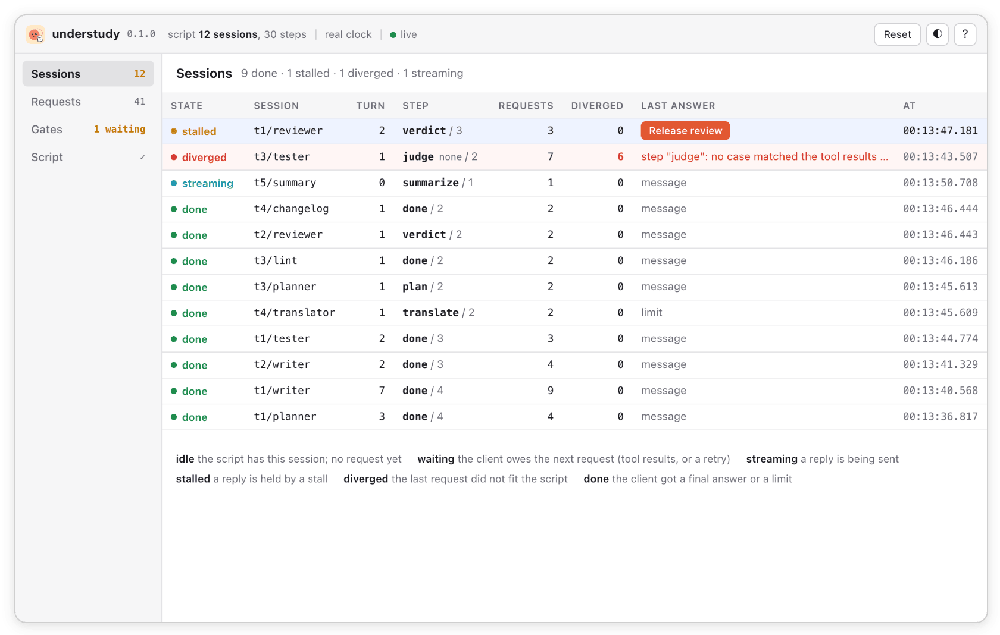
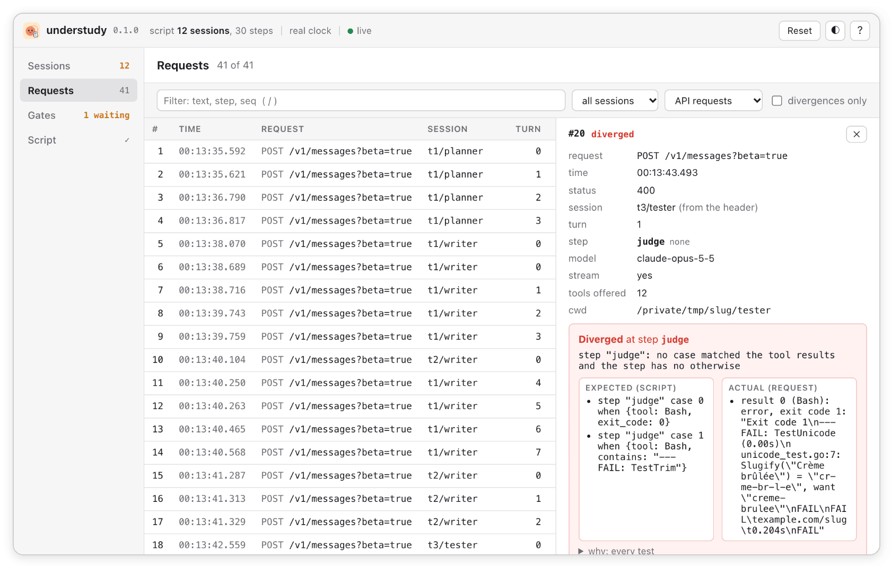
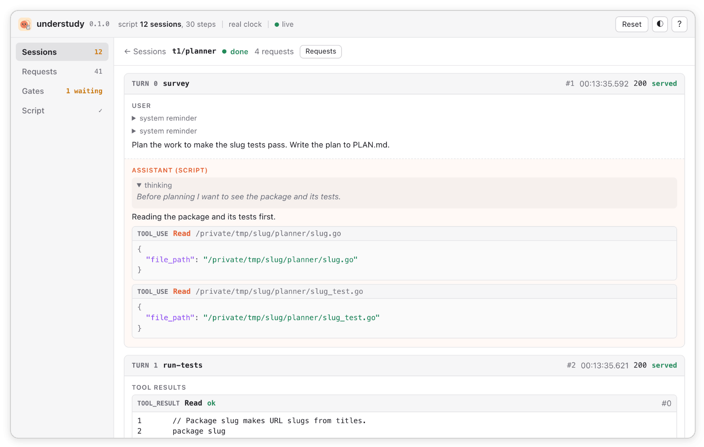
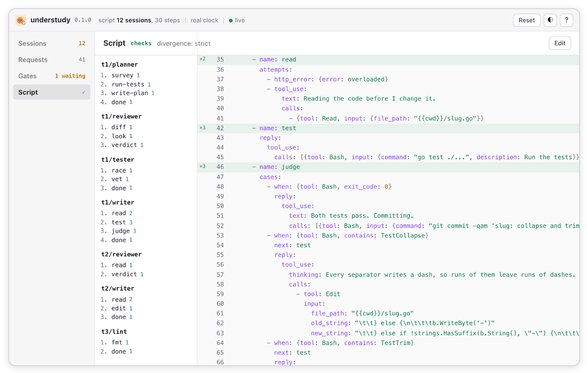
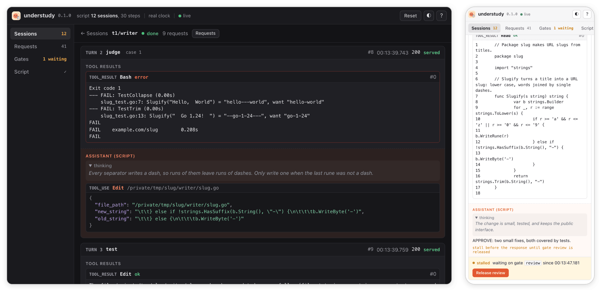

# Web UI

`understudy serve` answers a web UI at `/_understudy/ui/` on the same address (`--ui off` turns it
off). It is a thin page over the [control API](control-api.md): no build step to run, nothing loaded from
the network, assets embedded in the binary, live through Server-Sent Events.

- **Sessions**: every session the script names or the log has seen, with its state: `idle`,
  `waiting` (the client owes the next request), `streaming`, `stalled` (held at a gate, with a
  Release button), `diverged` or `done`; its turn, the step that answered, and counts.
- **A session** reads as a conversation: the prompt (Claude Code's system reminders folded), the
  tool results each request carried, and what the script answered (thinking, text, tool calls
  with their inputs, HTTP and in-stream errors, usage limits, stalls and cuts), each turn labelled
  with the step and case that answered it. Retries of a refused request fold into one line.
- **Divergences** are red, with what the script expected beside what the request carried and
  every test that ran.
- **Requests**: the whole log, filtered by text, session, outcome or divergences only, with a
  detail pane (trace, tool results, earlier turns, headers).
- **Gates** with who waits on them; **Script**: the loaded YAML, highlighted, with how many
  requests each step answered (red where one diverged); Edit checks a new script as you type
  and loads it.

Keyboard: `1`-`4` switch views, `j`/`k` move, `Enter` opens, `Esc` goes back, `/` filters, `r`
releases the gate of the selected session, `t` switches light and dark, `?` lists the keys.

## Screenshots

<table>
  <tr>
    <td width="50%" valign="top"> Sessions</td>
    <td width="50%" valign="top"> Requests, with a diverged request open</td>
  </tr>
  <tr>
    <td width="50%" valign="top"> A session as a conversation</td>
    <td width="50%" valign="top"> The loaded script</td>
  </tr>
  <tr>
    <td colspan="2"> Dark mode, and a 390 px wide phone</td>
  </tr>
</table>

The screenshots are real sessions of Claude Code 2.1.327 against `understudy serve`: twelve
sessions taking a small Go package from plan to review. A planner reads the code and writes a
plan; a writer gets a 529 and retries, then fixes two failing tests in a loop of edits and test
runs and commits; a docs writer gets a 429 and retries; a tester's run fails a test no case
expected (the divergence, retried five times by Claude Code); another hits the weekly limit; a
reviewer is held at a gate; a summary is still streaming.
